# R2H
주가 급등 국면 포착 에이전트 (2026.9~2027.6, 홍익대학교 졸업 프로젝트)

## T12 최종 연구 읽기와 재현 (2026-10-16)

이 브랜치의 T12는 국내 ETF 20종에 SVR–GARCH 분산 추정과 잔차 제곱 CUSUM을 적용한 **연도별 사후 분산 검정**이다. 가격 상승 방향, 온라인 급등 시작, 진입·청산 수익률을 검증한 연구가 아니다. 2021–2025 완결 5년을 핵심 기간으로 읽고, 2020은 학습 1년 파일럿, 2026은 10월 2일까지의 부분·비블라인드 기간으로 구분한다.

최종 공식 노트북은 [00 환경과 데이터 검증](notebooks/00_환경과_데이터_검증.ipynb) → [01 연간 확장 실험 재현](notebooks/01_연간확장_실험재현.ipynb) → [02 가설 검증과 심층 해석](notebooks/02_가설검증_강건성_심층해석.ipynb) 순서다. 세 파일은 [생성기](scripts/t12_build_reproduction_notebook.py)의 같은 셀 정의에서 만들어진다. Claude B의 이전 단일 노트북은 Git 커밋 `871dc62`/`76e8b03`에서 복구할 수 있다.

재현에는 이 R2H 저장소의 고정 `data/raw` 20 ETF 파일과 R2H `.venv`가 필요하다. 원자료는 원격에서 다시 받지 않는다. 새 작업트리에서는 `data`가 기존 R2H 원자료를 가리키는 로컬 symlink다. 다른 환경이라면 `data/raw`를 같은 SHA의 읽기 전용 자료로 배치하고, `T12_JUPYTER`를 호환 Jupyter 실행 파일로 지정한다. Python 3.12.3, numpy 2.5.4, pandas 3.0.6, scikit-learn 1.9.1이 기준이다.

```bash
python scripts/t12_build_reproduction_notebook.py  # 빈 노트북 3개 재생성; 저장 출력이 지워지므로 제출본에는 실행하지 않는다
python scripts/run_t12_final_notebooks.py           # 00→01→02 각각 새 커널; 01은 약 11분
```

두 번째 명령은 01에서 매번 전체 20 ETF × 2020–2026을 순차 실행하고 새 `run_id` 결과를 `outputs/t12/`에 기록한다. 02는 바로 그 결과의 Semantic·Verdict 지문을 확인한 뒤 도판을 만든다. 실행별 로그는 `outputs/t12/final/`, 고정 프로토콜·기준 결과는 `research/t12_annual_expanding_v2/`에 있다. 이번 검증의 [재현 보고](research/t12_annual_expanding_v2/FINAL_REPRODUCTION_REPORT.md), [파일별 SHA256 매니페스트](research/t12_annual_expanding_v2/FINAL_RELEASE_MANIFEST.json), [한국어 발표 그림 6종](research/t12_annual_expanding_v2/presentation/), [연구 종결 보고와 주장–근거 표](FINAL_RESEARCH_CLOSURE.md)를 함께 읽는다. 원본 자료·결과·Claude 작업트리는 변경하지 않았으며 원격 push는 하지 않았다.

<p>
  <a href="https://github.com/nanahyun3/R2H/actions/workflows/ci.yml?query=branch%3A1012"></a>
  
  
  
  
  
  
  
  
</p>

> **1012 브랜치 = 2조·4조 공통 연구 기준선.** 지금까지의 연구 3건(ETF EDA · 상관 전환 · SVR–GARCH CUSUM 논문 재현)을 **다시 실행해 재현 여부를 감사**했다.
> 그 결과에서 검증된 최소 코드(데이터 계약 · feature · 탐지 인터페이스 · 사건 평가)만 이 브랜치에 올렸다.
> 실제 ETF 탐지 성능 수치는 아직 없다. 정답(Ground Truth)이 승인되지 않았기 때문이다.

### 바로 가기

| 📓 노트북 | 📊 결과 | 📐 계약·결정 | 🔎 출처 |
|---|---|---|---|
| [**연구 종합 노트북**](notebooks/R2H_1012_research_synthesis.ipynb) · [nbviewer](https://nbviewer.org/github/nanahyun3/R2H/blob/1012/notebooks/R2H_1012_research_synthesis.ipynb)<br>[**T11 SVR–GARCH CUSUM × ETF 20종**](notebooks/R2H_T11_svr_garch_cusum_etf.ipynb) · [nbviewer](https://nbviewer.org/github/nanahyun3/R2H/blob/1012/notebooks/R2H_T11_svr_garch_cusum_etf.ipynb) | [재현 상태표](research/REPRODUCTION_STATUS.md) · [Track A](research/cross_asset_track_a.md) · [Track B](research/svr_garch_cusum_track_b.md) · [EDA](research/etf_domain_eda.md) · [**T11**](research/svr_garch_cusum_etf/README.md) | [계약 v0.1](docs/architecture/CONTRACT_v0.1.md) · [열린 결정](docs/decisions/OPEN_DECISIONS.md) · [인계·일정](docs/handoff/HANDOFF_1012.md) | [코드 출처](docs/provenance/PROVENANCE.md) · [원본 parity](docs/provenance/PARITY.md) · [파일 manifest](research/SOURCE_TO_TARGET_MANIFEST.csv) |

---

## 1. 한눈에 보는 결론

| 연구 | 질문 | 재현 | 판정 | 실무 적용 |
|---|---|---|---|---|
| **ETF Domain EDA** (20종) | ETF 들은 어떤 구조로 같이·따로 움직이나 | ✅ 결과표 309개 바이트 동일 | **CLOSED** | ✅ 유니버스·중복 노출·변동성 정규화 규칙으로 사용 |
| **Track A — 상관 전환** | KOSPI200 과의 상관 부호 전환이 급등을 알려 주나 | ✅ 결과표 43종 독립 2회 동일 | **부정적 결과** — 같은 날 기계적 중복을 빼면 우연 수준 | ❌ 정답·조기경보로는 사용 불가 · ⚠️ 국면 기술용으로만 |
| **Track B — SVR–GARCH CUSUM** ([Lee·Kim·Lee 2020](https://doi.org/10.3390/e22050578)) | 원 논문 결과가 재현되나 | ✅ 계산은 결정적으로 재현 (MC 400회 일치) | **METHOD_FIDELITY_UNRESOLVED** — 원문 수치 미재현 | ⚠️ 사후 검정(`posthoc`)으로만 · 온라인 경보 아님 |
| **T11 — SVR–GARCH CUSUM × ETF 20종** | 이 탐지기를 ETF 에 70/30 으로 적용하면 무엇을 잡고, Track A·EDA 경계와 맞나 | ✅ 오토런 2회 결과표 바이트 동일 · 노트북 2회 동일 | 정책 A 경보율 **iid 기준 미만** (w=60 0.39 vs 1.71/년) · 사건 근접 **우연 수준** (1차 가족 34 검정, 최소 q 0.57) | ❌ 급등 탐지기로 사용 불가 · ⚠️ 변동성 국면 맥락으로만 (기준선) |
| **R2H 1012 기준선** | 2조·4조가 같은 입력·출력·평가로 비교할 수 있나 | ✅ clean-room · 하한 의존성 · CI | 계약 **v0.1 제안** | ✅ CUSUM·BOCPD 를 같은 표로 교환·채점 |

<p align="center">
  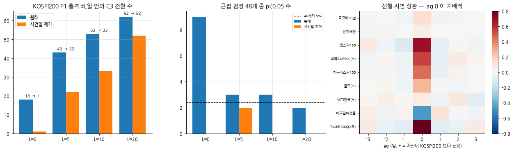
  <br><sub>Track A — 사건일 수익률을 지우면 같은 날 근접 18→1건, 유의 검정 9/48→0/48. lead-lag 은 lag 0 이 지배적.</sub>
</p>

---

## 2. 기술 스택

| 영역 | 사용 |
|---|---|
| 언어·환경 | Python 3.11+ (검증 3.12.3) · [uv](https://docs.astral.sh/uv/) + `uv.lock` · hatchling |
| 계산 | numpy ≥ 2.0 · pandas ≥ 2.2 · scipy ≥ 1.13 (하한 버전으로도 CI 통과) · scikit-learn (ε-SVR, `--extra research`) |
| 데이터 수집 | FinanceDataReader (`--extra research`, 원시 시세는 저장소 밖 — 종가 해시로 버전 검증) |
| 품질 | pytest (unit · integration · property · leakage) · [hypothesis](https://hypothesis.readthedocs.io/) (결정적 프로필) · ruff · mypy |
| 시각화·노트북 | matplotlib · nbclient / ipykernel (`--extra notebook`) · **한글 폰트 나눔고딕** (+ 그리스 문자 DejaVu 대체) · 노트북 규칙 = 모든 코드 줄 한국어 주석 (테스트로 강제) |
| CI | GitHub Actions — lint → type → test → 합성 예제 2회 바이트 비교 · 최저 의존성 job |
| 연구 원본 | [Siegfriex/SA_ETF](https://github.com/Siegfriex/SA_ETF) — EDA `main` · [Track A 브랜치](https://github.com/Siegfriex/SA_ETF/tree/codex/r2h-track-a) · [Track B 브랜치](https://github.com/Siegfriex/SA_ETF/tree/research/track-b-paper2020/research/track_b_paper2020) |
| 원 논문 | Lee, S., Kim, C. K., & Lee, S. (2020). *Hybrid CUSUM Change Point Test for Time Series with Time-Varying Volatilities Based on Support Vector Regression.* **Entropy** 22(5), 578 — [doi:10.3390/e22050578](https://doi.org/10.3390/e22050578) · [MDPI 원문 (open access)](https://www.mdpi.com/1099-4300/22/5/578) |
| 데이터 소스 | [FinanceDataReader](https://github.com/FinanceData/FinanceDataReader) 0.9.202 (KRX 상장 ETF 일봉) · [Yahoo Finance](https://finance.yahoo.com/) chart API (`^GSPC` `^KS11` `KRW=X`, 원문 [Investing.com](https://www.investing.com/) 대체) |

---

## 3. 데이터 명세 · 카드

> 원시 시세는 재배포 권리를 확인하지 못해 **이 저장소에 넣지 않는다**. 각자 받은 파일이 기준 연구와 같은 바이트인지 `r2h.data.verify_manifest` 로 확인한다
> (기준 해시: SA_ETF [`data/raw/MANIFEST.csv`](https://github.com/Siegfriex/SA_ETF/blob/main/data/raw/MANIFEST.csv)).
> 노트북은 원시 시세 대신 SA_ETF 의 **공개 결과표**(커밋 SHA 고정 + sha256 검증)만 읽는다.

### 3.1 데이터 카드 — 국내 상장 ETF 20종 (ETF EDA · Track A)

| 항목 | 내용 |
|---|---|
| 출처 | `FinanceDataReader.DataReader(ticker, "2019-01-01")` — KRX 상장 ETF 일봉 OHLCV |
| 기간·크기 | 2019-01-02 ~ 2026-10-02 · ticker 당 1,903행 · 공통 거래일 1,902 수익률 |
| 버전 | 데이터 버전 = sorted `ticker:sha256` 의 sha256 → `fd9713f7f985e950…` (20/20 해시 일치 확인) |
| 가격 조정 | FDR `Close` 는 분배 소급조정으로 **추정** (069500/KS200 누적비 1.155 ≈ TR 1.163). O/H/L 조정 일관성은 보장되지 않음 (D-06) |
| 품질 이슈 | 261240 2019-03-14·15 이상치 → `dq_trim_canonical` 은 그 두 셀만 NaN (행 유지·보간 없음) · 153130 수익률이 정확히 0 인 날 16.8% · OHLC 위반 212건 (Close 기반 분석엔 영향 없음) |
| 중복 노출 | 069500·102110·122630·114800 은 KOSPI200 동일 노출 → **사건 1건** |
| 편향 | 현재 상장·규모 기준 선정 (survivorship) — PROVISIONAL 유니버스 (D-04) |
| 2026 | 069500 변동성이 2019–25 평균의 3.3배인 특이 국면, 탐색에 이미 쓰인 구간 → blind holdout 아님 |

<details>
<summary><b>ETF 20종 명세 (클릭)</b> — 연환산 변동성·KOSPI200(069500) 상관은 전체표본 raw 기준</summary>

| ticker | 이름 | 분류 | 기초지수 | 환헤지 | 배율 | 연변동성 | ρ(069500) |
|---|---|---|---|---|---|---|---|
| 069500 | KODEX 200 | broad_market | KOSPI 200 | KRW | – | 28.5% | 1.00 |
| 102110 | TIGER 200 | broad_market | KOSPI 200 | KRW | – | 28.4% | 1.00 |
| 229200 | KODEX 코스닥150 | broad_market | KOSDAQ 150 | KRW | – | 33.5% | 0.69 |
| 122630 | KODEX 레버리지 | leveraged_inverse | KOSPI 200 (일간 2배) | KRW | 2x | 56.6% | 1.00 |
| 114800 | KODEX 인버스 | leveraged_inverse | KOSPI 200 선물 (일간 −1배) | KRW | −1x | 29.1% | −1.00 |
| 091230 | TIGER 반도체 | sector | KRX 반도체 (추정) | KRW | – | 39.0% | 0.86 |
| 091170 | KODEX 은행 | sector | KRX 은행 (추정) | KRW | – | 27.4% | 0.53 |
| 091180 | KODEX 자동차 | sector | KRX 자동차 (추정) | KRW | – | 31.3% | 0.66 |
| 305540 | TIGER 2차전지테마 | theme | FnGuide 2차전지 (추정) | KRW | – | 40.8% | 0.57 |
| 143860 | TIGER 헬스케어 | sector | KRX 헬스케어 (추정) | KRW | – | 30.8% | 0.51 |
| 117680 | KODEX 철강 | sector | KRX 철강 (추정) | KRW | – | 32.7% | 0.59 |
| 161510 | PLUS 고배당주 | strategy | FnGuide 고배당주 (추정) | KRW | – | 21.2% | 0.65 |
| 219480 | KODEX 미국S&P500선물(H) | broad_market | S&P 500 선물 | 헤지 | – | 18.9% | 0.54 |
| 133690 | TIGER 미국나스닥100 | broad_market | NASDAQ-100 | 비헤지 | – | 21.2% | 0.45 |
| 192090 | TIGER 차이나CSI300 | broad_market | CSI 300 | 비헤지 (추정) | – | 20.3% | 0.28 |
| 148070 | KIWOOM 국고채10년 | rates | 국고채 10년 (추정) | KRW | – | 6.1% | 0.13 |
| 153130 | KODEX 단기채권 | money_market | 단기채 (추정) | KRW | – | 0.3% | 0.05 |
| 132030 | KODEX 골드선물(H) | commodity | S&P GSCI Gold (추정) | 헤지 | – | 18.8% | 0.27 |
| 261220 | KODEX WTI원유선물(H) | commodity | S&P GSCI Crude Oil (추정) | 헤지 | – | 47.9% | 0.06 |
| 261240 | KODEX 미국달러선물 | currency | KRX USD/KRW 선물 | USD 롱 | – | 13.5% | −0.31 (DQ 2일 제외 시 −0.46) |

</details>

### 3.2 데이터 카드 — 논문 재현용 지수 3종 (Track B)

| series | 원문 출처 | 사용 출처 (SOURCE_SUBSTITUTED) | 기간 (= 원문) | 관측치 |
|---|---|---|---|---|
| S&P 500 | Investing.com (HTTP 403) | Yahoo `^GSPC` 종가 | 2012-01-03 ~ 2016-09-30 | 1,195 |
| KOSPI | Investing.com | Yahoo `^KS11` 종가 | 2012-10-02 ~ 2019-06-28 | 1,653 |
| KRW/USD | Investing.com | Yahoo `KRW=X` | 2012-01-02 ~ 2016-09-30 | 1,238 |

수익률 = 100·Δlog (원문 그림 축이 % 라서 그렇게 추정). 시계열의 URL·sha256 은 [`data_manifest.json`](https://github.com/Siegfriex/SA_ETF/blob/research/track-b-paper2020/research/track_b_paper2020/data/raw/data_manifest.json) 에 있다.

### 3.3 입력 계약 (요약 — 전체는 [CONTRACT_v0.1](docs/architecture/CONTRACT_v0.1.md))

| 객체 | 필수 필드 | 규칙 |
|---|---|---|
| 관측 | `ticker` (str, 선행 0 유지) · `date` (tz-naive 거래일) · `adj_close` > 0 · `volume` ≥ 0 | (ticker, date) 중복 금지 · 오름차순 · 해외자산은 `observed_at` (tz-aware) |
| 탐지 출력 | `ticker, signal_at, score, is_alarm, method_id, mode, model_version, data_version, available_until, params_hash` | `mode="online"` 이면 **`available_until ≤ signal_at`** 강제 |
| 정답 사건 | `label_version, event_id, ticker, event_start, event_end, direction, threshold_definition, created_from_window` | 오프라인 전용 · 탐지기 출력으로 만들지 않음 |
| 체결 | `signal_at ≤ decision_at < fill_at` | 같은 봉 체결 금지 |

---

## 4. 수식 · 알고리즘

<details open>
<summary><b>4.1 Feature (과거 정보만 — t 종가 이후 이용 가능)</b></summary>

$$r_t=\ln C_t-\ln C_{t-1},\qquad z_t=\frac{r_t}{\hat\sigma_{t-1}(w)},\quad \hat\sigma_{t-1}(w)=\operatorname{sd}(r_{t-w},\dots,r_{t-1})$$

$$\rho_t(w)=\operatorname{corr}\big(r^{(a)}_{t-w+1:t},\,r^{(b)}_{t-w+1:t}\big)\quad(\text{pairwise-complete; }n_\text{eff}<\text{min\_periods}\text{ 또는 분산 }0\Rightarrow\text{NaN})$$

**지속 부호 국면 (C3)**: $|\rho_t|>b$ 이고 같은 부호가 $k$ 거래일 연속이면 국면 확정. 확정 시점 $=$ 후보 시점 $+(k-1)$ 거래일이다 (주 정의 $b=0.1,k=10$ ⇒ 9 거래일 지연).
</details>

<details>
<summary><b>4.2 참조 온라인 탐지기 (합성 데이터에서만 검증)</b></summary>

- `VolScaledThreshold`: $\;\text{alarm}_t=\mathbb 1[z_t\ge k]$ (SA_ETF Track A 가격 사건 P1 과 같은 점수, `min_periods=40` 이면 비트 동일).
- `PageCUSUM` (Page 1954, 단측):

$$\tilde z_t=\frac{r_t-\bar r_{t-w:t-1}}{\hat\sigma_{t-1}(w)},\qquad S_t=\max\big(0,\;S_{t-1}+\tilde z_t-\delta\big),\qquad \text{alarm}_t=\mathbb 1[S_t\ge h]\;\Rightarrow S_t\leftarrow 0$$
</details>

<details>
<summary><b>4.3 Lee·Kim·Lee (2020) Hybrid SVR–GARCH CUSUM — 사후 검정</b></summary>

1. 변동성 proxy: $\tilde\sigma^2_t=\frac1m\sum_{j=0}^{m-1}y^2_{t-j}$, $m=5$ (Eq. 9).
2. ε-SVR(RBF) 로 $\hat\sigma^2_t=\hat g\big(y^2_{t-1},\tilde\sigma^2_{t-1}\big)$ 를 적합한다. 커널 $\exp(-\lVert x-x'\rVert^2/2\gamma^2)$ ↔ sklearn `gamma = 1/(2γ²)`. 파라미터는 grid 와 검증 MAE 로 고른다.
3. 표준화 잔차 $\hat\epsilon_t=y_t/\hat\sigma_t$ 의 CUSUM of squares:

$$T_n=\max_{1\le k\le n}\frac{\big|\sum_{t\le k}\hat\epsilon_t^2-\tfrac kn\sum_{t\le n}\hat\epsilon_t^2\big|}{\sqrt n\,\hat\tau},\qquad \hat\tau^2=\overline{\hat\epsilon^4}-\big(\overline{\hat\epsilon^2}\big)^2,\qquad T_n\ge 1.3397\Rightarrow\text{기각 (5\%)}$$

변화점 추정은 $\hat k=\arg\max_k|\cdot|$ 이다. 표본 전체를 보는 **사후 검정**이므로 R2H 에서는 `PosthocCUSUMSquares` (`mode="posthoc"`) 로만 쓴다.
테스트 구간에서 $\hat g$ 에 넣을 분산 lag(관측 proxy A / 재귀 예측 B)는 **원문에 명시되어 있지 않다**.
</details>

<details>
<summary><b>4.4 평가 — 사건 매칭 · 지표 · 우연 수준</b></summary>

- **매칭**: cooldown 을 먼저 적용한다. 사건 $e$ 의 창 $[s_e-\text{pre},\,s_e+\text{max\_delay}]$ 안의 첫 경보가 TP 이고, 같은 사건의 이후 경보는 DUPLICATE, 어느 창에도 들지 않으면 FP 다.
- **지표**: $\text{recall}=\frac{\#\text{탐지 사건}}{\#\text{사건}}$, $\;\text{FP}/\text{ticker-year}=\frac{\#\text{FP}}{\sum_\text{ticker}N_\text{days}/252}$. 지연은 탐지된 사건만 평균하고 미탐 수를 따로 보고한다. 주 지표는 **오탐 상한 하 탐지율** `recall_at_fp_cap`.
- **근접의 우연 수준 (원형 이동)**: $T=\#\{c:\exists p,\ |p-c|\le L\}$, $\;p=\frac{1+\#\{T^*\ge T\}}{B+1}$. 여러 검정은 Benjamini–Hochberg q 로 보정한다.
</details>

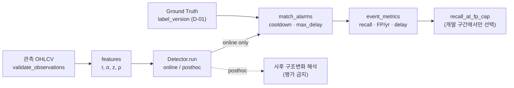

---

## 5. 실험 결과 — 재현되었나, 적용 가능한가

전체 그림과 해석은 [**연구 종합 노트북**](notebooks/R2H_1012_research_synthesis.ipynb) 에 있다 (그림 10장, 핵심 수치는 `assert` 로 검증).

### 5.1 ETF Domain EDA

<p align="center">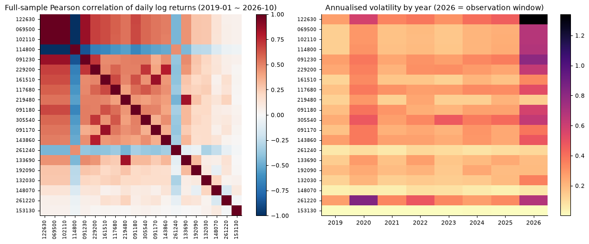</p>
<p align="center">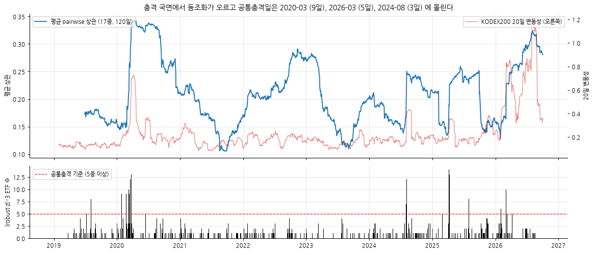</p>

- 국내 주식형 ETF 끼리는 상관이 0.5–1.0 이다. KOSPI200 계열 4종은 사실상 같은 노출이라 사건 1건으로 센다.
- 채권·금·원유는 KOSPI200 과 거의 독립(ρ 0.05–0.27)이고, 달러선물만 일관되게 음(−0.46, DQ 제외)이다.
- 평균 상관은 충격 국면에서 계단식으로 오른다. 공통충격일 40일 중 2020-03(9일)·2026-03(5일)·2024-08(3일)이 가장 크다.
  따라서 "상관 변화" 와 "변동성 국면" 은 독립 신호가 아니다.
- **재현**: SA_ETF `d5c2f79` 을 clean clone 에서 다시 실행 → csv·png 309개 바이트 동일, 노트북 21개는 메타데이터만 다름. **적용**: 유니버스 정의·중복 노출 규칙·변동성 정규화(r/σ) 의 근거로 쓴다.

### 5.2 Track A — 상관 전환 vs 가격 급등·급락 (부정적 결과)

<p align="center">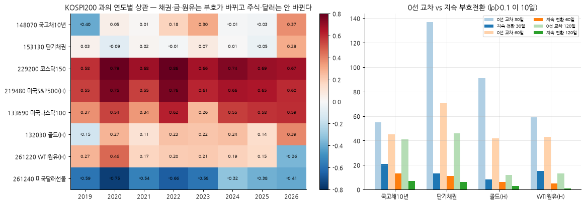</p>
<p align="center">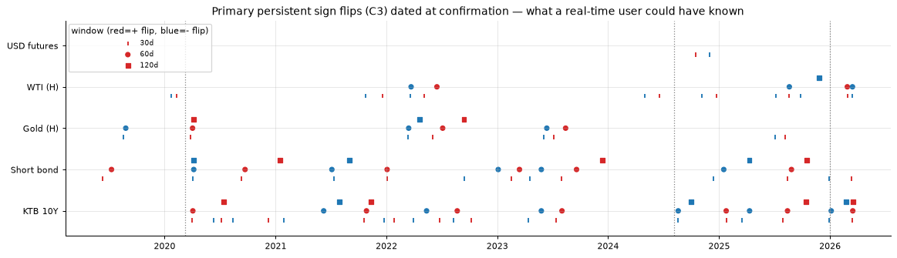</p>

| 확인한 수치 (원 표에서 재계산) | 값 |
|---|---|
| 148070(국고채10년)–KOSPI200 연도별 ρ | 2019 **−0.40** → 2026 **+0.37** (부호가 바뀜) |
| 148070 60일 0선 교차 → 지속 전환 | 45 → **13** (나머지는 잡음) |
| 같은 날 근접 / 유의 검정 (사건일 제거 전→후) | **18→1** / **9/48→0/48** |
| p<0.05 비율 L=0/5/10/20 (45,280 검정) | 11.2 / 8.0 / 6.8 / **5.1%** (우연 수준으로 수렴) |
| 사전 지정 1차 가족 BH q<0.10 | 586 중 3 (모두 사건 2–6개 조합) |

<p align="center">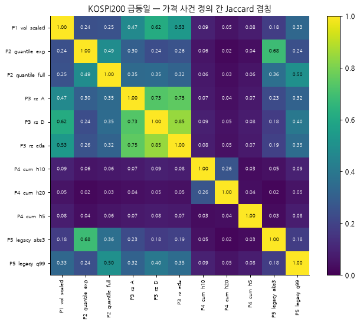</p>

- "급등" 정의끼리도 겹침이 작다 (robust-z 3종 Jaccard 0.73–0.85, 일간 vs 누적 0.02–0.09). **정답 정의(D-01)를 먼저 확정해야** 탐지율을 매길 수 있다.
- **재현**: 독립 2회 실행에서 결과표 43종이 동일했다. 보고서 claim 29개 중 27개가 일치하고 2개는 문구를 정정했다 (11.1 달력일 → 주 정의 9거래일 ≈ 13.4일 · lag 0 최대 → WTI 예외).
- **적용**: ❌ 급등 정답·조기경보로는 쓰지 않는다 · ⚠️ 채권·금·원유의 국면 기술과 사건일 제거 후 진단에만 쓴다 · `features.correlation` + `evaluation.null_tests` 로 이식했다.

### 5.3 Track B — SVR–GARCH CUSUM 논문 재현 (원문 미재현)

<p align="center">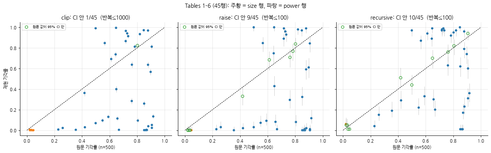</p>
<p align="center">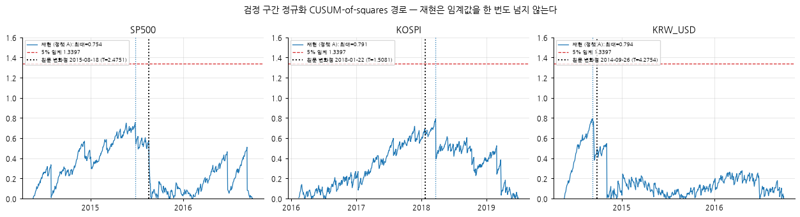</p>
<p align="center">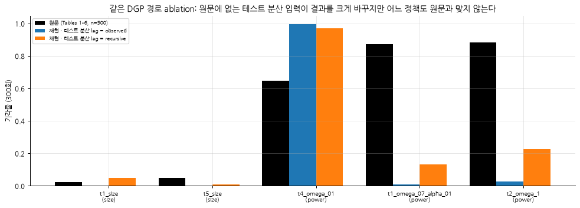</p>

| | 원문 | 재현 |
|---|---|---|
| Tables 1–6 (n=500, 45행) — 원문이 재현 95% CI 안 | — | clip(1000회) **1/45** · raise 9/45 · recursive 10/45 |
| S&P500 / KOSPI / KRW·USD 통계량 | 2.48 / 1.51 / 4.28 (모두 기각) | 0.75 / 0.79 / 0.79 (정책 A, 모두 비기각) |
| 결정성 | — | pytest 84/84 · 실증 바이트 동일 · MC 400회 재생성 완전 일치 |

- 원문에 명시되지 않은 테스트 구간 분산 lag 정책이 결과를 크게 바꾼다 (같은 경로 McNemar p≈1e-152). 그러나 **어느 정책으로도 원문 표가 재현되지 않는다**. 원문에 가까운 정책을 사후에 고르지 않았다.
- **적용**: ⚠️ 검정 모듈만 원본과 바이트 동일하게 이식했다 (`detection/paper2020_cusum.py`). R2H 에서는 **사후 검정** `mode="posthoc"` 로만 쓰고, 온라인 평가에 넣으면 오류가 난다.
  ETF 결과를 "원문 방법의 결과" 라고 부르지 않는다. prefix-only 온라인 변형은 W04 과제다.

### 5.4 R2H 계약 시연 (합성 데이터 — 실제 성능 아님)

<p align="center">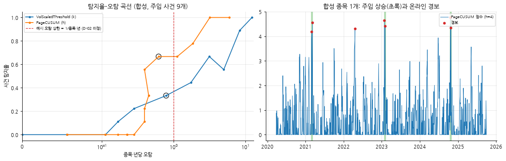</p>

- 같은 정답·매칭 규칙에서 탐지기별 **탐지율–오탐 곡선**을 그리고, `recall_at_fp_cap` 으로 오탐 상한 안의 설정을 고른다. 2조 CUSUM·4조 BOCPD 도 같은 출력 계약만 지키면 이 그림에 같이 올라간다.
- 실제 상한값·지연 허용·cooldown 은 미결정(D-02)이다.

### 5.5 T11 — SVR–GARCH CUSUM 을 ETF 20종에 적용 (70/30 · 이동창 20/30/60/120/252 · Track A·EDA 대비)

설계·데이터 카드·수식·결과표: [`research/svr_garch_cusum_etf/README.md`](research/svr_garch_cusum_etf/README.md) · 노트북: [`R2H_T11_svr_garch_cusum_etf.ipynb`](notebooks/R2H_T11_svr_garch_cusum_etf.ipynb) (그림 16장, 그림마다 해석)

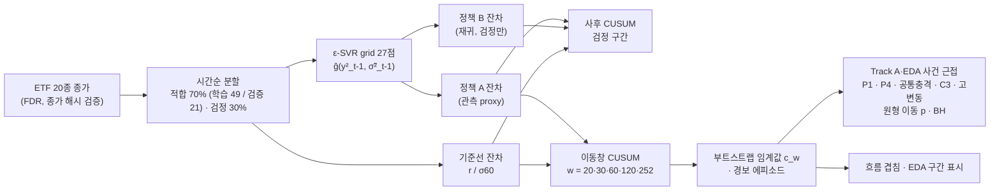

<p align="center">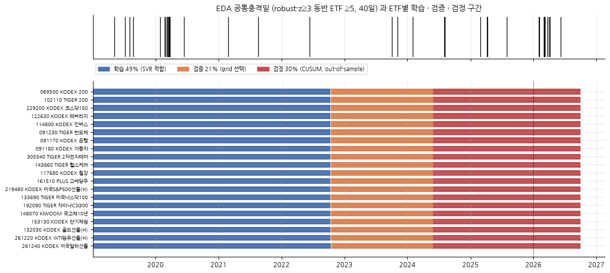</p>
<p align="center">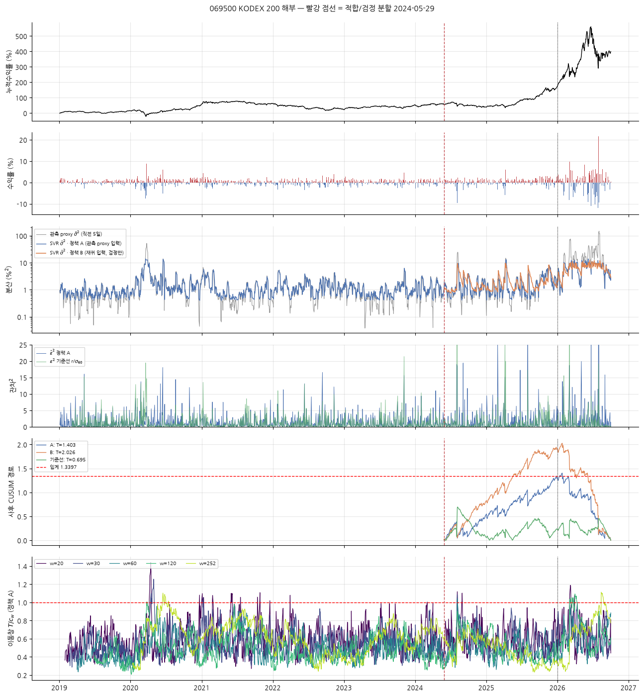</p>

- **해부 (069500)**: 정책 A 의 σ̂² 는 직전 5일 proxy 를 거의 그대로 따라가 변동성 상승을 바로 흡수한다. 검정 구간 사후 CUSUM 은 **정책 A T=1.403 (기각) · B 2.026 (기각) · 기준선 0.695 (비기각)**.

<p align="center">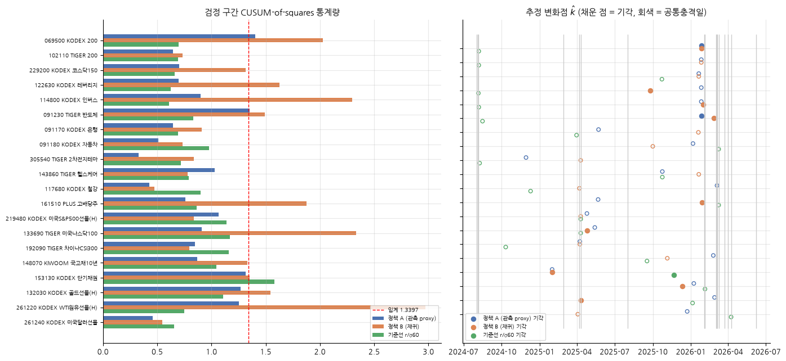</p>

- **사후 검정 20종**: 기각 정책 A 2/20 · 정책 B 9/20 · 기준선 1/20. 원문에 없는 테스트 분산 입력 규칙 하나로 기각 수가 4.5배 달라진다. k̂ 는 대부분 2026-01 (알려진 고변동 국면 시작).

<p align="center">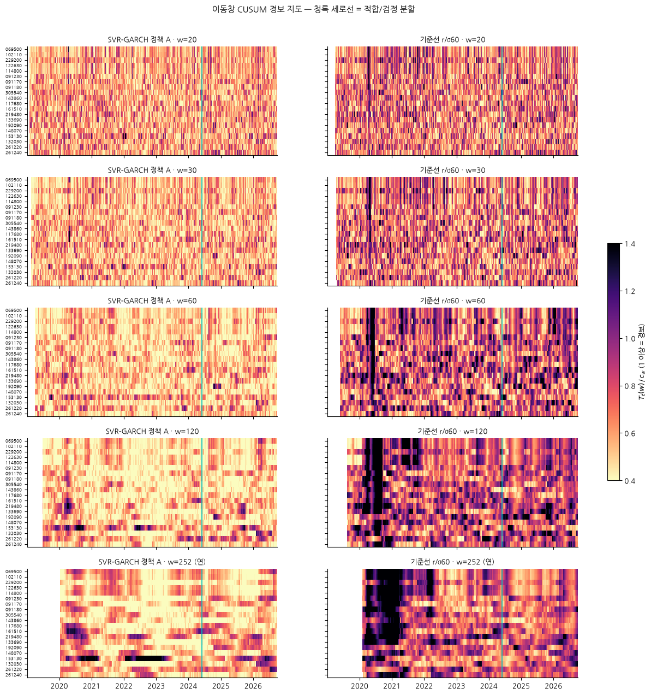</p>
<p align="center">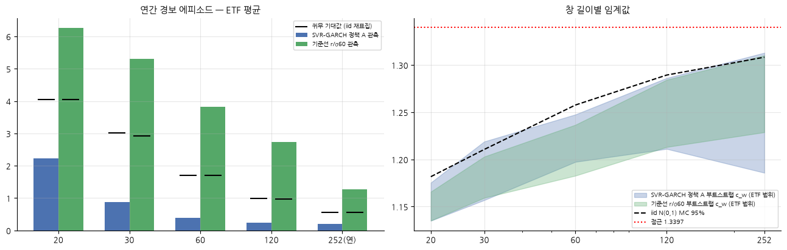</p>

- **창 20·30·60·120·252**: 기준선은 모든 창에서 경보가 iid 기준값보다 많다 (w=60 연 3.82 vs 1.70, 20종 모두) — 2020·2026 변동성 국면을 잡는다. **정책 A 는 모든 창에서 적다** (0.39 vs 1.71, 초과 0/20) — 이 설정의 CUSUM 은 사실상 검정력이 없다. 기준값은 iid 재표집이라 변동성 군집 아래의 오탐 보정은 아니다. 짧은 창의 유한표본 임계값(1.14–1.18)은 점근 1.3397 보다 훨씬 낮다.

<p align="center">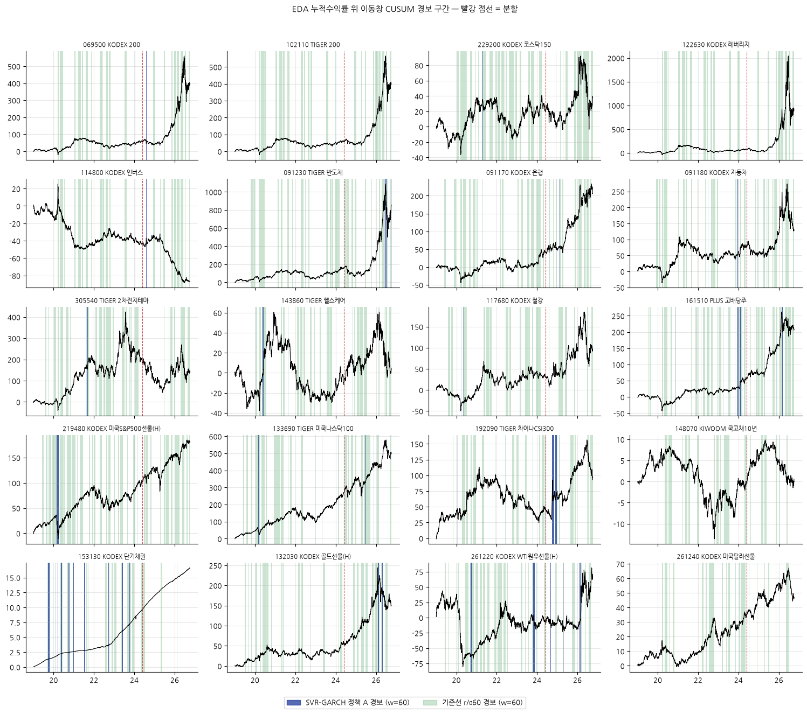</p>

<table><tr>
<td>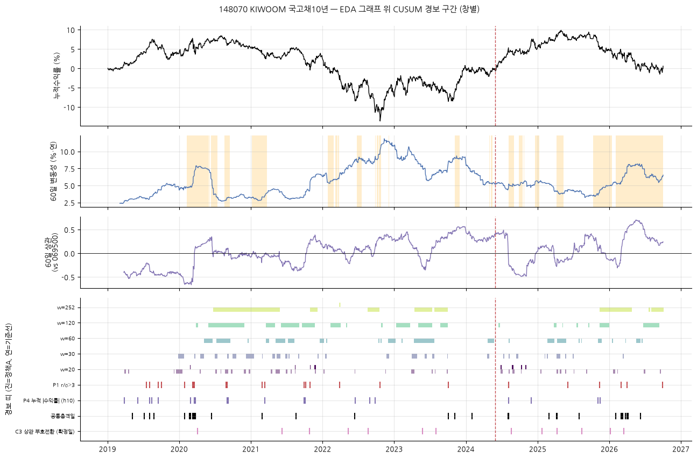</td>
<td>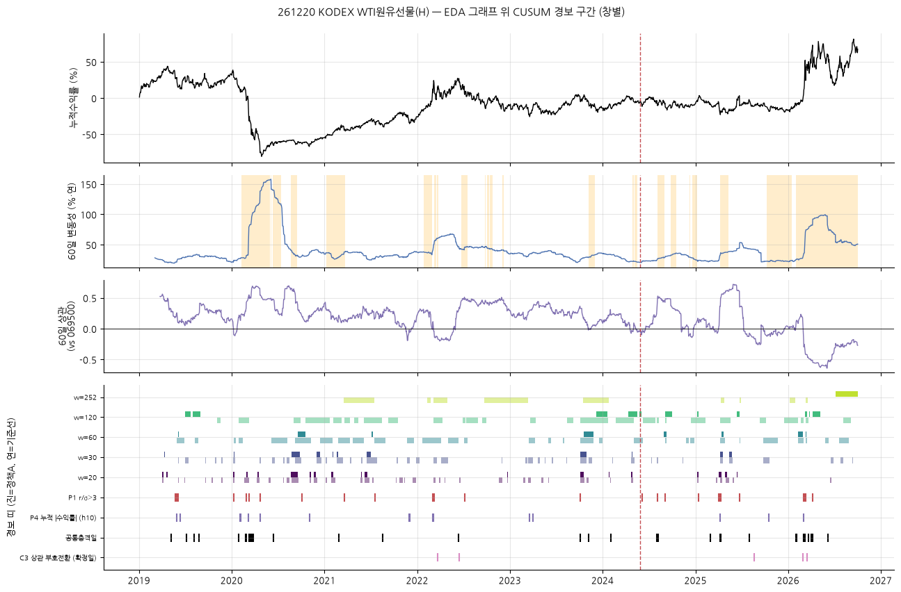</td>
</tr><tr>
<td>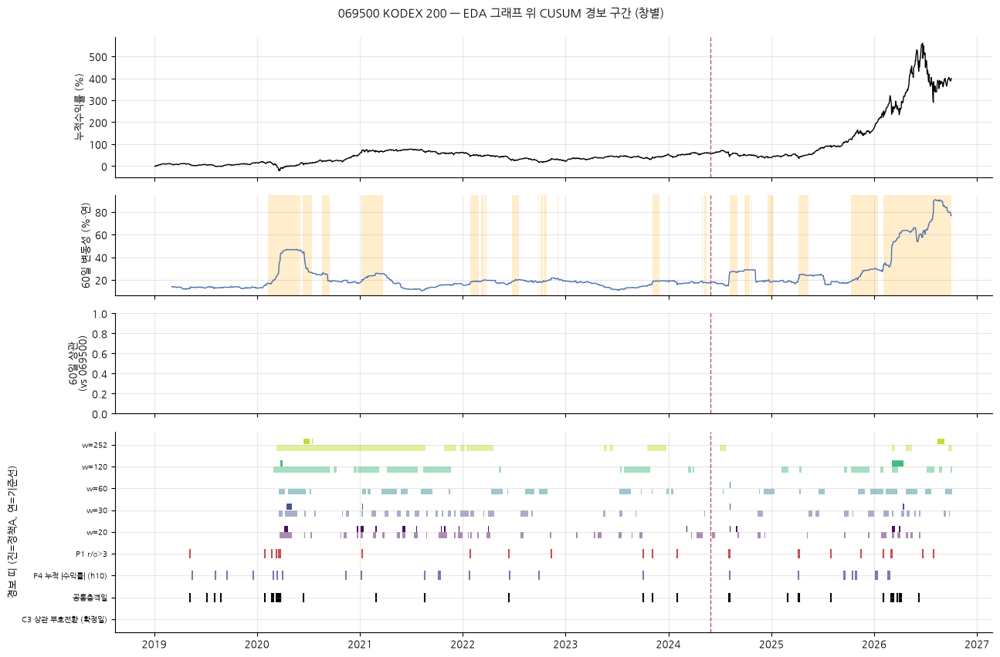</td>
<td>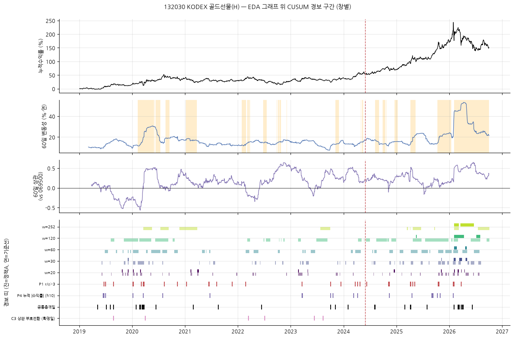</td>
</tr></table>

- **EDA 그래프 위 구간**: w=60 경보 에피소드 기준선 577개 · 정책 A 59개. 국고채10년(148070)은 정책 A 경보가 w=60·120 에서 0건. 경보는 사건(P1·P4·공통충격) **당일·직후**에 시작한다 — 선행이 아니라 반응.

<p align="center">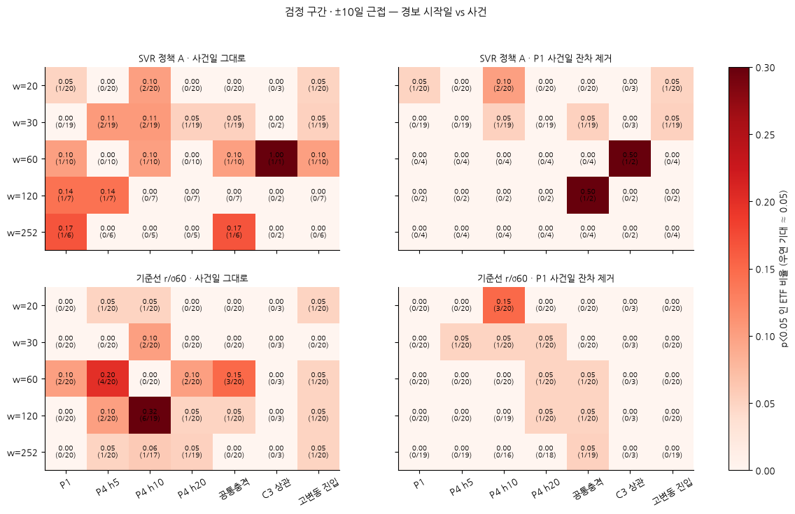</p>
<p align="center">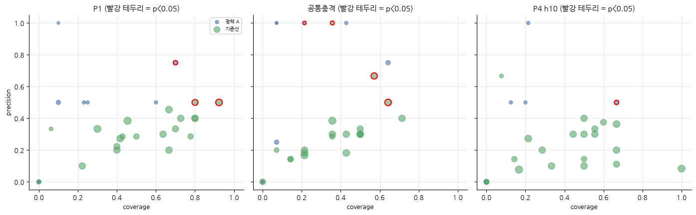</p>

- **정합성**: 23,442 검정의 p<0.05 비율 5.9% (우연 수준에 가까움, 대부분 in-sample). 사전 등록 1차 가족 **34 검정**(KOSPI200 그룹 1건, 검정 불가 행 p=1) 중 p<0.05 2개, **최소 q=0.57**. P1 사건일 잔차를 빼면 기준선 8.9%→4.6%, 정책 A 6.6%→2.6% — 남는 겹침은 같은 날 큰 수익률과 2026 기저율 때문 (Track A 와 같은 결론). 독립 검토로 1차 가족 크기·검정 구간 경계(분할일+w−1)를 정정한 뒤의 값이다.

<p align="center">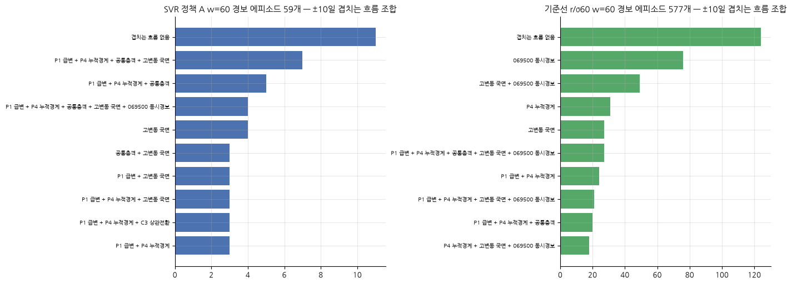</p>
<p align="center">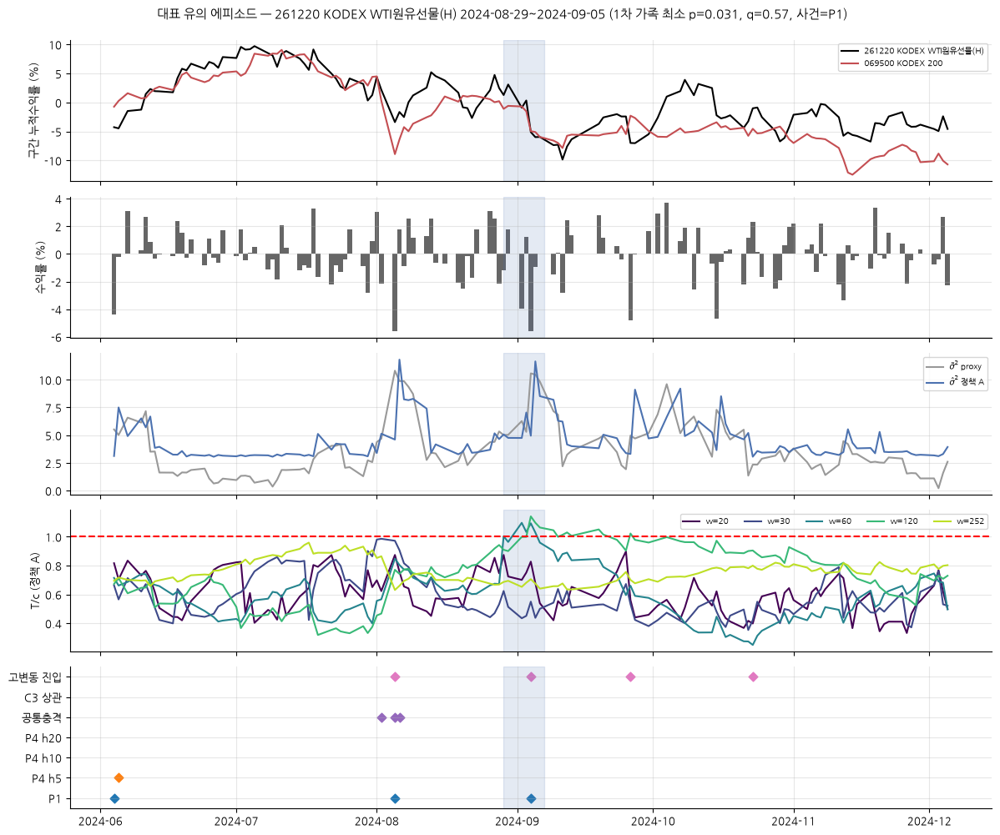</p>

- **유의 경보일 때 겹치는 흐름**: 정책 A 경보 59개 중 P1 59% · P4 53% · 공통충격 46% · 고변동 49%. 대표 에피소드(사전 규칙으로 자동 선택) 261220 WTI원유 2024-08-29: 2024-08 세계 급락 직후의 변동성 군집 속에서 켜진 경보 — 새 국면의 조기경보가 아니라 진행 중인 충격에 대한 반응.

<p align="center">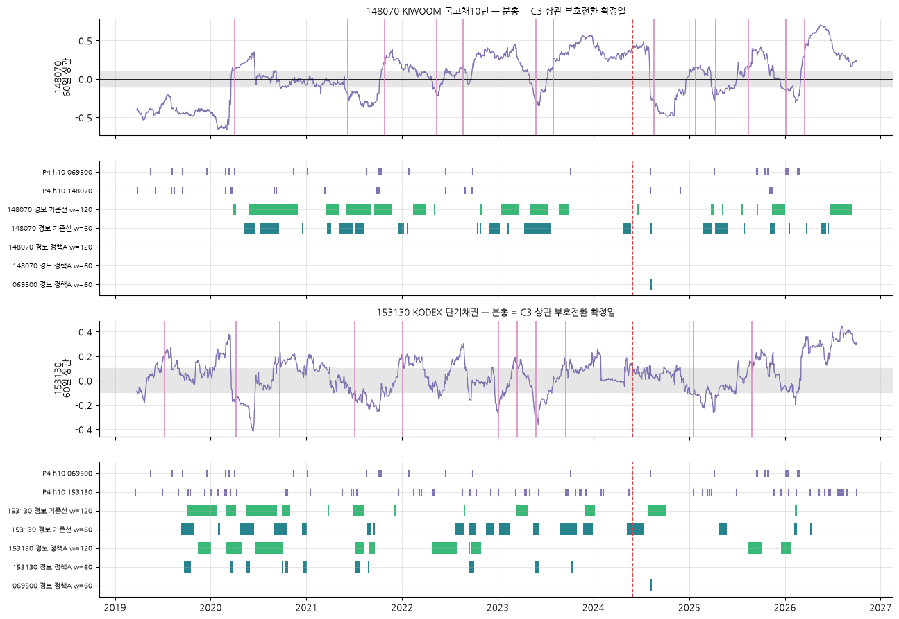</p>
<p align="center">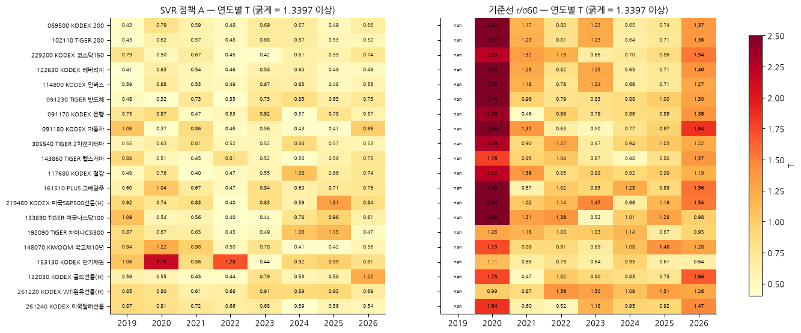</p>

- **채권↔KOSPI · 연도 블록**: CUSUM-of-squares(변동성 구조) · C3(상관 부호 국면) · P4(누적수익률 절대값 경계)는 서로 다른 것을 재며 우연 이상 겹치지 않는다 (148070 기준선 vs C3 p=0.23; 153130 의 정책 A 근접은 in-sample 적합 구간에서만). 기준선 연도 블록은 2020 85% · 2026 55% 기각으로 EDA 고변동 해와 정확히 맞는다.

<details>
<summary><b>그림을 그대로 재현하는 코드 셀 (예: 이동창 경보 지도의 한 칸)</b></summary>

```python
# 결과표만으로 재현 (원시 시세 불필요): 이동창 통계량과 ETF 별 부트스트랩 임계값
import pandas as pd

# 이동창 통계량 (날짜 × "ticker|잔차|창")
roll = pd.read_csv("research/svr_garch_cusum_etf/results/rolling_stats.csv.gz", index_col=0, parse_dates=True)
# 임계값 표
crit = pd.read_csv("research/svr_garch_cusum_etf/results/critical_values.csv", dtype={"ticker": str})
# 069500 · 정책 A · w=60 의 임계값
c = crit.query("ticker == '069500' and rtype == 'svrA' and window == 60")["c_bootstrap"].iloc[0]
# T/c ≥ 1 인 날 = 경보일
alarm_days = roll.index[roll["069500|svrA|60"] / c >= 1]
# 경보일 수와 처음 몇 날
print(len(alarm_days), list(alarm_days[:5].date))
```

노트북의 모든 코드 셀이 같은 결과표(`research/svr_garch_cusum_etf/results/`, 정본)와 로컬 상태(`outputs/cache/t11_state.npz`, 원시 시세가 필요한 해부·EDA 그림용)에서 그림을 만든다.
</details>

**적용 가능성 판정** — ❌ 정책 A SVR–GARCH CUSUM 은 급등 탐지기로 쓸 수 없다 · ⚠️ 정책 B·기준선은 원문 미명시 선택에 결과가 좌우되므로 병기만 · ⚠️ 기준선 변동성 CUSUM 은 방향 없는 국면 맥락으로만 · ❌ Track A 경계(C3·P4)와 정합성 없음 → W04 다음 단계는 **평균·방향 CUSUM** 을 승인된 정답(D-01)으로 평가.

---

## Quickstart

```bash
git clone https://github.com/nanahyun3/R2H.git && cd R2H
git checkout 1012
uv sync --extra dev                       # uv.lock 기준으로 .venv 생성
uv run pytest                             # unit · integration · property · leakage
uv run ruff check . && uv run ruff format --check . && uv run mypy
uv run python examples/synthetic_demo.py --out outputs/synthetic_demo.json
uv sync --extra dev --extra notebook && uv run jupyter execute notebooks/R2H_1012_research_synthesis.ipynb   # 노트북 (첫 실행만 네트워크)
uv sync --extra dev --extra notebook --extra research                       # T11 (SVR–GARCH × ETF)
uv run python scripts/run_svr_garch_cusum_etf.py                            # 오토런 (원시 시세: ETF_RAW_DIR 또는 FDR 자동, 종가 해시 검증)
uv run jupyter execute notebooks/R2H_T11_svr_garch_cusum_etf.ipynb
```

uv 없이: `python3 -m venv .venv && . .venv/bin/activate && pip install -e ".[dev]" && pytest` (버전은 lock 이 아니라 `pyproject.toml` 범위로 풀린다).

`examples/synthetic_demo.py` 는 **합성 데이터**(주입한 상승 drift 를 정답으로 둠)에서 두 참조 탐지기를 돌려 사건 수준 지표를 출력한다.
같은 config 로 두 번 실행하면 출력 JSON 이 같아야 하며, CI 가 이를 확인한다. 이 수치는 실제 ETF 성능이 아니다.

## 사용 예

아래 블록은 테스트(`tests/integration/test_readme_example.py`)가 그대로 실행한다. 실제 데이터에서는 `returns` 를 일간 로그수익률
(`r2h.features.log_returns`)로, `truth` 를 승인된 정답 표로 바꾼다.

```python
from r2h.detection import VolScaledThreshold
from r2h.evaluation import MatchConfig, event_metrics, match_alarms
from r2h.synthetic import InjectedSurge, ground_truth_from_injections, surge_series

surges = [InjectedSurge(start=300, length=10, drift=0.012)]
returns, calendar = surge_series(1000, surges, seed=1)  # 합성 일간 로그수익률 (실제 시세 아님)
truth = ground_truth_from_injections(calendar, surges, ticker="SYN")

signals = VolScaledThreshold(window=60, k=3.0).run(returns, ticker="SYN", data_version="synthetic")
alarms, events = match_alarms(signals, truth, calendar, MatchConfig(max_delay=5, cooldown=5, direction=1))
print(event_metrics(alarms, events, ticker_years=len(calendar) / 252))
```

새 탐지기(CUSUM 최종본·BOCPD 등)는 `r2h.detection.Detector` 프로토콜(`method_id`·`model_version`·`mode`·`params()`·`run()`)을 따르고
`build_signal_frame` 으로 출력하면 매칭·지표를 그대로 쓸 수 있다.

## 저장소 구조

| 경로 | 내용 | 상태 |
|---|---|---|
| [`src/r2h/data/`](src/r2h/data) | 관측 계약 검증 · as-of 절단 · manifest/데이터 버전 | 제안 v0.1 |
| [`src/r2h/features/`](src/r2h/features) | 로그수익률 · 변동성 · 이동평균 · 거래량비 · r/σ · rolling 상관 · 부호 국면 | 원본과 비트 동일 parity |
| [`src/r2h/detection/`](src/r2h/detection) | 출력 계약 · `Detector` · 참조 탐지기 · 사후 CUSUM-of-squares | REFERENCE / posthoc |
| [`src/r2h/evaluation/`](src/r2h/evaluation) | 정답 계약 · 매칭 · 지표 · 분할(walk-forward) · 귀무검정 | 제안 v0.1 |
| [`src/r2h/backtest/`](src/r2h/backtest) | 체결 시점 규칙 · 비용 함수 | **SCHEMA_ONLY** |
| [`notebooks/`](notebooks) | [연구 종합 노트북](notebooks/R2H_1012_research_synthesis.ipynb) · [T11 SVR–GARCH × ETF](notebooks/R2H_T11_svr_garch_cusum_etf.ipynb) | 실행 결과 포함 · 모든 코드 줄 한국어 주석 |
| [`src/r2h/paper2020/`](src/r2h/paper2020) · [`src/r2h/svrgarch_etf/`](src/r2h/svrgarch_etf) | Track B 원본 모듈(바이트 동일) · T11 오토런 | sensitivity 적용 |
| [`scripts/`](scripts) | [T11 오토런](scripts/run_svr_garch_cusum_etf.py) | |
| [`research/`](research) | 감사된 연구 요약 · 재현 상태 · 출처 manifest · [후속 제안](research/proposals/README.md) | |
| [`docs/`](docs) | [계약](docs/architecture/CONTRACT_v0.1.md) · [결정](docs/decisions/OPEN_DECISIONS.md) · [인계](docs/handoff/HANDOFF_1012.md) · [출처](docs/provenance/PROVENANCE.md) · [그림](docs/figures) | |
| [`tests/`](tests) | unit · integration · property · leakage · 노트북 규칙 (98) | CI |

## 규칙

- 온라인 신호는 `available_until <= signal_at` (검증 함수가 강제). 사후 검정은 `mode="posthoc"` 이며 온라인 평가에 넣을 수 없다.
- 정답 라벨은 탐지기와 독립된 정의로 만든다. 미래 구간을 본 라벨은 평가에만 쓴다.
- 임계값·하이퍼파라미터는 개발 구간에서만 고른다. 2026 은 기존 EDA 가 이미 본 데이터라 blind holdout 이 아니다.
- 원시 시세·API 키·개인정보·저작권 PDF 는 커밋하지 않는다 (`.gitignore`).

## 열린 결정 (교수·4조 확인 필요)

D-01 Ground Truth 정의 · D-02 오탐 상한/지연/cooldown · D-03 개발·검증·관찰 구간과 2026 처리 · D-04 공식 유니버스 · D-05 robust-z 표준 ·
D-06 수정주가 정책 · D-07 LICENSE · D-08 패키지 관리자 · D-09 Track B 테스트 lag 정책 → [OPEN_DECISIONS.md](docs/decisions/OPEN_DECISIONS.md)
