# R2H · `1012_SVR-GARCH-CUSUM` — SVR–GARCH CUSUM 을 ETF 20종에 적용한 연구의 최종 재평가

<p>
  
  
  
  
  
  
  
</p>

> 이 브랜치는 `1012` (`a346faf`) 에서 갈라져, **T11 연구(SVR–GARCH CUSUM × ETF 20종)의 최종 재평가 결과만** 담는다. 코드·결과표는 `1012` 와 같고, 추가된 것은 [`deliverables/R2H_T11_CUSUM_Final_Review/`](deliverables/R2H_T11_CUSUM_Final_Review) (보고서·재계산·확장 실험·그림·검증 문서) 와 이 README 다.
> 연구자가 정의한 가격·상관 사건(P1·P4·C3·공통충격)을 정답으로 쓰는 평가는 **판단 근거에서 뺐다**. 대신 검정 자체의 통계적 성질 — 크기(size)·검정력(power)·모형 의존성 — 을 재계산과 합성 자료 실험으로 평가했다.

## 바로 가기

| 📄 최종 보고서 | 🔎 검증 | 🧪 실행 | 📚 배경 |
|---|---|---|---|
| [**PDF (32쪽)**](deliverables/R2H_T11_CUSUM_Final_Review/R2H_T11_SVR_GARCH_CUSUM_최종연구보고서.pdf) · [DOCX (편집용)](deliverables/R2H_T11_CUSUM_Final_Review/R2H_T11_SVR_GARCH_CUSUM_최종연구보고서.docx) | [소스–주장 대응표](deliverables/R2H_T11_CUSUM_Final_Review/SOURCE_EVIDENCE_MATRIX.md) · [재현성 감사](deliverables/R2H_T11_CUSUM_Final_Review/REPRODUCIBILITY_AUDIT.md) · [변경·미해결](deliverables/R2H_T11_CUSUM_Final_Review/CHANGELOG_AND_OPEN_ISSUES.md) · [일치성 검수 결과](deliverables/R2H_T11_CUSUM_Final_Review/analysis/consistency_check.json) | [스크립트 01–08](deliverables/R2H_T11_CUSUM_Final_Review/scripts) · [claims.json](deliverables/R2H_T11_CUSUM_Final_Review/claims.json) · [확장 실험 결과](deliverables/R2H_T11_CUSUM_Final_Review/extension) | [T11 원 README](research/svr_garch_cusum_etf/README.md) · [T11 노트북](notebooks/R2H_T11_svr_garch_cusum_etf.ipynb) · [Track B 감사](research/svr_garch_cusum_track_b.md) · [1012 공통 README](docs/README_1012_baseline.md) |

---

## 0. 세 줄 요약

1. **계산은 믿을 수 있다.** 같은 커밋을 서로 다른 두 환경에서 다시 돌리면 결과표 9종이 바이트 단위로 같고, KODEX 200 교란 검사에서 검정 구간의 미래 자료가 과거 판단에 새지 않았다.
2. **검정의 성질이 좋지 않다.** 합성 GARCH 자료에서 이 파이프라인의 거짓 기각률(크기)은 정책 A 2.4% · 정책 B 34% · 기준선 24.6% (목표 5%), 분산이 3배로 바뀌어도 정책 A 가 잡는 비율(검정력)은 19% 다. 크기와 검정력을 함께 만족하는 설정이 없다.
3. **그래서 ETF 결과(기각 A 2 · B 9 · 기준선 1 /20)로는 '구조변화가 있다/없다' 를 확정할 수 없다.** 같은 KOSPI200 을 따르는 KODEX 200 과 TIGER 200 도 SVR 설정 선택에 따라 결론이 갈린다. 다음 단계는 탐지기 개선이 아니라 **시장 상태의 정의와 식별 가능성 검증**이다.

---

## 1. 이 연구가 묻는 것 — 처음 보는 사람을 위한 설명

R2H 의 큰 목표는 **ETF 가격이 급등하는 국면을 포착**하는 것이다. 그 후보 도구로 Lee·Kim·Lee (2020, *Entropy* 22(5):578, [doi:10.3390/e22050578](https://doi.org/10.3390/e22050578)) 의 **SVR–GARCH CUSUM 검정**을 ETF 에 적용해 봤다. 이 검정이 실제로 보는 것은 다음과 같다.

| 질문 | 이 검정이 답하는가? |
|---|---|
| 가격이 **오르는가/내리는가** (방향) | ❌ 보지 않는다. 제곱을 쓰므로 +5% 와 −5% 가 같다 |
| 수익률의 **흔들림(분산)이 어느 시점에 바뀌었는가** | ✅ 이것만 본다 — '분산 구조변화' 검정 |
| 그 변화가 **투자에 쓸모 있는가** | ❌ 측정하지 않았다 |

즉 이 검정은 '급등 탐지기' 가 아니라 **'조건부 변동성을 모형으로 걷어낸 뒤에도 남는 분산 변화가 있는가'** 를 묻는 통계 검정이다. 이 보고서의 질문도 그렇게 다시 세웠다.

> **RQ1** SVR–GARCH 로 표준화한 잔차에 구조변화가 남는가 · **RQ2** 분산 입력 정책 A/B 에 따라 결과가 어떻게 바뀌는가 · **RQ3** 관측창(20–252일)에 따라 · **RQ4** 임계값의 귀무모형(iid 재표집)은 타당한가 · **RQ5** 같은 지수 ETF 끼리 일관적인가 · **RQ6** 검출 결과를 '시장 상태' 로 해석하려면 무엇이 더 필요한가

**왜 기존 사건 평가를 뺐나?** 기존 T11 은 경보가 P1(급등·급락 후보), P4(누적수익률 경계), C3(상관 부호전환), 공통충격일과 가까운지를 검정했다. 그런데 이 사건들은 연구자가 임계값·기간을 정해 만든 것이라 '정답' 이 아니고, P1 의 점수(r/σ₆₀)는 기준선 잔차와 **같은 식**이라 겹침의 일부는 기계적이다. 그래서 결과 파일은 그대로 두고, 판단에는 쓰지 않았다. 대신 **변화 시점을 알고 만든 합성 자료**로 검정력을 쟀다.

---

## 2. 데이터 — 무엇을 넣었나

| 항목 | 내용 |
|---|---|
| 대상 | 국내 상장 ETF 20종 (아래 표) |
| 출처 | [FinanceDataReader](https://github.com/FinanceData/FinanceDataReader) 0.9.202, KRX 일봉 종가. 원시 시세는 저장소에 넣지 않는다 |
| 기간 | 종가 2019-01-02 ~ 2026-10-02 → 공통 거래일 수익률 **1902개** |
| 변환 | 일간 로그수익률 × 100 → 단위 %. 261240 은 품질 문제 2일을 결측 처리 |
| 버전 고정 | 종가 원문 sha256 20/20 대조 (다르면 실행 중단) · data_version `5f20e3e0073b521a` |
| 분할 | 시간순 **앞 70% 적합** (학습 932 / 검증 399일) → **뒤 30% 검정** 571일, 분할일 **2024-05-29** |

| 코드 | 종목 | 분류 | 연율화 변동성 적합 구간 | 검정 구간 | 코드 | 종목 | 분류 | 적합 | 검정 |
|---|---|---|--:|--:|---|---|---|--:|--:|
| 069500 | KODEX 200 | 시장 지수 | 19.6% | 42.4% | 117680 | KODEX 철강 | 업종 | 28.1% | 41.5% |
| 102110 | TIGER 200 | 시장 지수 | 19.4% | 42.5% | 161510 | PLUS 고배당주 | 전략 | 19.7% | 24.2% |
| 229200 | KODEX 코스닥150 | 시장 지수 | 28.9% | 42.3% | 219480 | KODEX 미국S&P500선물(H) | 시장 지수 | 19.4% | 17.5% |
| 122630 | KODEX 레버리지 | 레버리지·인버스 | 38.8% | 84.6% | 133690 | TIGER 미국나스닥100 | 시장 지수 | 20.9% | 21.9% |
| 114800 | KODEX 인버스 | 레버리지·인버스 | 20.0% | 43.2% | 192090 | TIGER 차이나CSI300 | 시장 지수 | 19.5% | 21.9% |
| 091230 | TIGER 반도체 | 업종 | 29.6% | 54.8% | 148070 | KIWOOM 국고채10년 | 국채 10년 | 6.3% | 5.5% |
| 091170 | KODEX 은행 | 업종 | 25.8% | 30.7% | 153130 | KODEX 단기채권 | 단기채 | 0.4% | 0.2% |
| 091180 | KODEX 자동차 | 업종 | 27.3% | 39.0% | 132030 | KODEX 골드선물(H) | 원자재 | 15.5% | 24.8% |
| 305540 | TIGER 2차전지테마 | 테마 | 36.6% | 49.4% | 261220 | KODEX WTI원유선물(H) | 원자재 | 48.5% | 46.4% |
| 143860 | TIGER 헬스케어 | 업종 | 28.7% | 35.1% | 261240 | KODEX 미국달러선물 | 통화 | 8.7% | 9.4% |

<sub>연율화 변동성 = 일간 수익률(%) 표준편차 × √252. KOSPI200 그룹(같은 기초지수) = 069500 · 102110 · 122630(2배) · 114800(−1배).</sub>

<p align="center">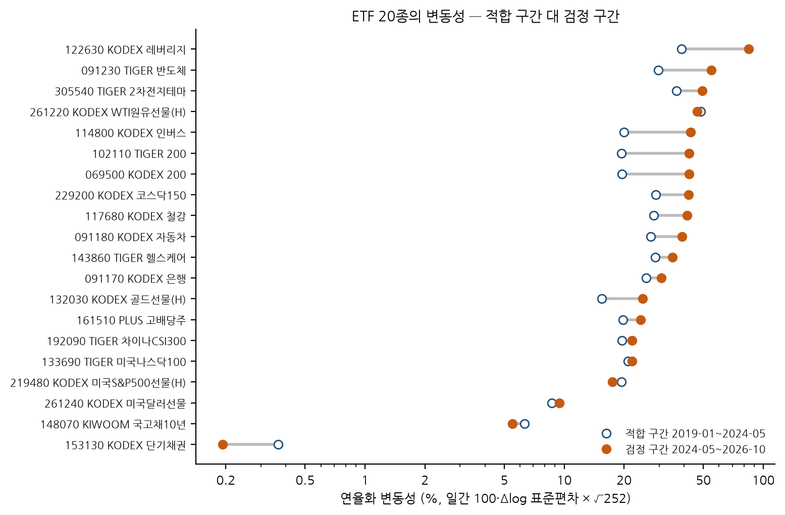<br><sub>그림 A. 20종 중 16종은 검정 구간의 변동성이 더 높다 (검정/적합 비 중앙값 1.29). KODEX 200 은 19.6% → 42.4%. 즉 검정 구간에 2026년 고변동기가 들어 있다.</sub></p>

<p align="center"><br><sub>그림 B. KODEX 200 한 종목의 해부 — 위에서부터 누적수익률, 일간 수익률, 분산(관측 proxy·정책 A·정책 B), 잔차², 사후 CUSUM 경로, 이동창 통계량/임계값. 빨강 점선 = 적합/검정 분할 (기존 T11 그림)</sub></p>

---

## 3. 지표 사전 — 보고서에 나오는 모든 숫자의 뜻

| 기호·이름 | 정의 | 읽는 법 |
|---|---|---|
| $y_t$ 수익률 | $100\cdot\Delta\log(\text{종가})$ | 하루 %. 2.0 이면 약 +2% |
| $\tilde\sigma_t^2$ 변동성 proxy | 직전 5일 수익률 제곱의 평균 $\frac15\sum_{j=0}^{4}y_{t-j}^2$ | 관측으로 바로 계산되는 '요즘 흔들림' |
| $\hat\sigma_t^2$ SVR–GARCH 조건부분산 | $\hat g(y_{t-1}^2,\tilde\sigma_{t-1}^2)$, $\hat g$ = 적합 구간에서 학습한 ε-SVR (RBF) | 어제까지 정보로 예측한 오늘의 분산 |
| 정책 A / 정책 B | 검정 구간에서 $\hat g$ 의 둘째 입력에 **관측 proxy** (A) / **직전 예측값** $\hat\sigma_{t-1}^2$ (B) 를 넣음 | 원 논문이 정하지 않은 선택. A = 1차, B = 민감도 |
| 기준선 | $r_t/\sigma_{t-1}(60)$ — 모형 없이 직전 60일 표준편차로 나눔 | SVR 이 주는 차이를 보기 위한 비교군 |
| $\hat\varepsilon_t$ 표준화 잔차 | $y_t/\hat\sigma_t$ | 모형이 맞으면 평균 0·분산 1 인 '놀람' |
| $T_n$ CUSUM-of-squares 통계량 | $\max_k\lvert\sum_{t\le k}\hat\varepsilon_t^2-\frac kn\sum\hat\varepsilon_t^2\rvert/(\sqrt n\,\hat\tau)$ | 잔차 제곱의 누적합이 '일정 분산 직선' 에서 가장 멀리 벗어난 정도. 클수록 분산 변화 의심 |
| $\hat\tau^2$ | $\overline{\hat\varepsilon^4}-(\overline{\hat\varepsilon^2})^2$ | 잔차 제곱의 분산 — 정규화 분모. **잔차가 독립이라고 가정** |
| $\hat k$ 변화점 추정 | $T_n$ 이 최대가 되는 위치 | 표본 전체를 본 **사후** 추정. 그날 실시간으로 알 수 있었다는 뜻이 아님 |
| 임계값 $c$ | 원문 1.3397 · Kolmogorov 이론값 1.3581 · iid N(0,1) 모의 95% · ETF 별 부트스트랩 95% | $T_n\ge c$ 이면 기각(분산 변화 있음) |
| $T_t(w)$ 이동창 통계량 | 최근 $w$ 일 창 $[t-w+1,t]$ 에 같은 검정, $w\in\{20,30,60,120,252\}$ | 매일 다시 계산 — 시점 $t$ 까지 정보만 사용 |
| 경보 · 에피소드 | $T_t(w)\ge c_w$ 인 날 = 경보일. 경보 사이 공백 ≤5일이면 한 에피소드 | 연간 경보 에피소드 = 에피소드 수 / (일수/252) |
| 크기 (size) | 변화가 **없는** 자료에서 기각하는 비율 | 5% 에 가까워야 정상. 크면 '없는 변화를 있다' 고 함 |
| 검정력 (power) | 변화가 **있는** 자료에서 기각하는 비율 | 클수록 좋음. 크기가 지켜질 때만 의미 |
| MC SE | 모의실험 비율의 표준오차 $\sqrt{p(1-p)/R}$ | R=500 이면 최대 ±2.2%p |
| 장기분산/τ̂² 비 | 잔차 제곱의 자기상관까지 반영한 분산 ÷ $\hat\tau^2$ | 1 미만 → 검정이 보수적(덜 기각), 1 초과 → 과다 기각 |
| iid 재표집 / stationary bootstrap | 적합 구간 잔차를 하루씩 독립 추출 / 평균 20일 블록으로 추출 | 서로 **다른 귀무가설**. 후자는 시계열 의존을 보존 |
| in-sample / out-of-sample | $\hat g$ 를 학습한 적합 구간 / 학습에 안 쓴 검정 구간 | 성능 판단은 out-of-sample 로만 |

---

## 4. 적용 절차 — 한 단계씩

<p align="center">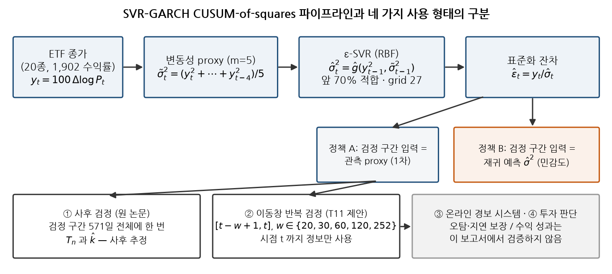<br><sub>그림 C. 파이프라인과 네 가지 사용 형태. 이 연구가 평가한 것은 ① 사후 검정과 ② 이동창 반복 검정의 통계적 성질뿐이다.</sub></p>

| 단계 | 하는 일 | 코드 | 산출물 |
|---|---|---|---|
| S0 데이터 | 종가 로드 → 해시 대조 → 공통 거래일 → 로그수익률(%) | `src/r2h/svrgarch_etf/data.py` | 1,902 × 20 수익률 |
| S1 적합 | 앞 70% 안에서 학습/검증 70:30, grid 27점(C·γ²·ε) 중 검증 MAE 최소 선택 → 앞 70% 전체로 재적합 | `model.fit_etf` ← `paper2020.svr_garch` | `results/fit_summary.csv` |
| S2 잔차 | 정책 A·B·기준선 세 가지 표준화 잔차 | `EtfFit.residuals`, `baseline_residuals` | `outputs/cache/t11_state.npz` |
| S3 사후 검정 | 검정 구간 571일 전체에 식 $T_n$ 한 번 → 기각·$\hat k$ | `paper2020.cusum_squares_test` | `results/fullsample_tests.csv` |
| S4 임계값 | 적합 구간 잔차 iid 재표집 5,000회 → 창 길이별 95% 분위 | `rolling.bootstrap_critical_value` | `results/critical_values.csv` |
| S5 이동창 | 매일 최근 w일 창에 $T_t(w)$ → 경보 → 에피소드 | `rolling.rolling_cusum`, `episodes` | `results/rolling_stats.csv.gz` |
| S6 재계산 (이번) | S3–S5 를 캐시 잔차에서 독립 재계산, 구간별 분모 분리 | `deliverables/R2H_T11_CUSUM_Final_Review/scripts/01_recompute.py` | `analysis/` |
| S7 확장 실험 (이번) | E1–E6 합성 자료 크기·검정력, 귀무 민감도, 시점 무결성, 잔차 의존성 | `deliverables/R2H_T11_CUSUM_Final_Review/scripts/02_extension.py` | `extension/` |

**CUSUM 은 어떻게 변화를 잡나?** 아래 교육용 예시에서 251번째 날부터 표준편차를 1.6배로 바꾸면, 잔차 제곱의 누적합이 '분산 일정' 직선에서 점점 멀어지다가 변화 시점 근처에서 가장 멀어진다. 그 최대 거리(정규화)가 $T_n$, 그 위치가 $\hat k$ 다.

<p align="center">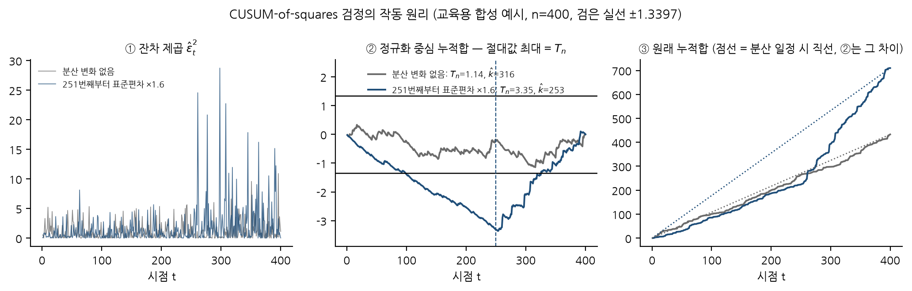<br><sub>그림 D. CUSUM-of-squares 의 작동 원리 (합성 예시, 실제 ETF 아님). 변화 없는 경우 Tₙ 이 임계값 아래, 변화 있는 경우 위로 크게 벗어난다.</sub></p>

$$T_n=\max_{1\le k\le n}\frac{\left|\sum_{t=1}^{k}\hat\varepsilon_t^2-\frac{k}{n}\sum_{t=1}^{n}\hat\varepsilon_t^2\right|}{\sqrt n\,\hat\tau},\qquad H_0:\ \mathbb E[\varepsilon_t^2]\ \text{일정}\quad\text{vs}\quad H_1:\ k^*\ \text{에서 변화}$$

> **임계값 주의.** 코드와 원 논문은 5% 임계값으로 **1.3397** 을 쓴다. 그런데 이 극한분포(Kolmogorov, sup|브라운 다리|)의 95% 분위를 직접 계산하면 **1.3581** 이고, 1.3397 은 상측 확률 0.0552 에 해당한다. 원문 값의 근거는 확인하지 못했다(UNRESOLVED). 짧은 창에서는 유한표본 분위가 훨씬 작다 (w=20: 1.182).

---

## 5. 결과 — 무엇이 나왔나

### 5.1 검정 구간 사후 검정 (RQ1·RQ2)

| 잔차 | 원문 1.3397 | Kolmogorov 1.3581 | N(0,1) 모의 1.3298 | ETF 별 부트스트랩 | T 중앙값 |
|---|--:|--:|--:|--:|--:|
| 정책 A | **2**/20 | 1 | 2 | 4 | 0.859 |
| 정책 B | **9**/20 | 8 | 9 | 11 | 1.323 |
| 기준선 | **1**/20 | 1 | 1 | 1 | 0.812 |

- 기각: 정책 A = 069500, 091230 · 정책 B = 069500, 122630, 114800, 091230, 161510, 133690, 153130, 132030, 261220 · 기준선 = 153130
- 정책 A 의 $\hat k$ 는 8/20 종이 **2026년 1월** — 그림 A 의 고변동기 시작과 겹친다. 단 사후 추정 위치다.
- 재계산 확인: 결과표와 차이 10⁻⁵ 미만, $\hat k$ 60/60 · 기각 60/60 일치.

<p align="center">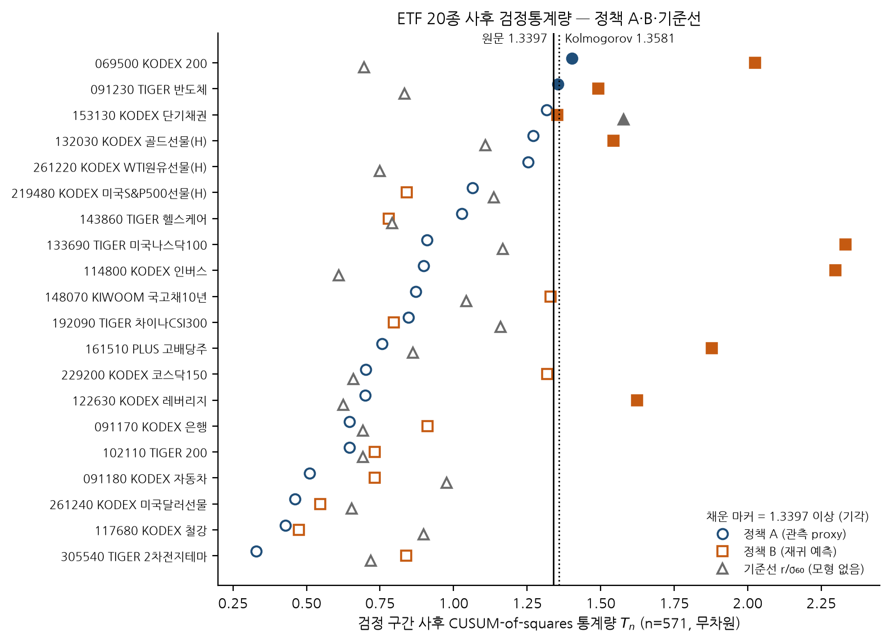<br><sub>그림 1. ETF 별 사후 통계량. 채운 마커 = 1.3397 이상(기각). 정책 B(■)가 대체로 오른쪽 — 그러나 5.6절에서 보듯 B 는 변화가 없어도 자주 기각한다.</sub></p>

<details><summary><b>ETF 20종 전체 표 펼치기</b></summary>

| 코드 | 종목 | SVR C/γ²/ε | T_A | k̂_A | T_B | k̂_B | T_기준선 |
|---|---|---|--:|---|--:|---|--:|
| 069500 | KODEX 200 | 1/0.5/0.1 | **1.403** | 2026-01-26 | **2.026** | 2026-01-26 | 0.695 |
| 102110 | TIGER 200 | 100/1/0.1 | 0.646 | 2026-01-26 | 0.731 | 2026-01-26 | 0.693 |
| 229200 | KODEX 코스닥150 | 10/0.5/0.1 | 0.702 | 2026-01-20 | 1.318 | 2026-01-20 | 0.659 |
| 122630 | KODEX 레버리지 | 10/1/0.1 | 0.699 | 2026-01-26 | **1.625** | 2025-09-25 | 0.625 |
| 114800 | KODEX 인버스 | 10/0.5/0.1 | 0.899 | 2026-01-26 | **2.298** | 2026-01-30 | 0.610 |
| 091230 | TIGER 반도체 | 1/1/0.1 | **1.354** | 2026-01-26 | **1.493** | 2026-02-25 | 0.833 |
| 091170 | KODEX 은행 | 1/1/0.1 | 0.647 | 2025-05-23 | 0.912 | 2026-01-19 | 0.692 |
| 091180 | KODEX 자동차 | 10/1/0.1 | 0.510 | 2026-01-06 | 0.732 | 2025-10-01 | 0.977 |
| 305540 | TIGER 2차전지테마 | 10/1/0.1 | 0.330 | 2024-11-29 | 0.840 | 2025-04-10 | 0.719 |
| 143860 | TIGER 헬스케어 | 1/1/0.1 | 1.028 | 2025-10-24 | 0.780 | 2026-01-20 | 0.792 |
| 117680 | KODEX 철강 | 1/0.5/0.1 | 0.429 | 2026-03-05 | 0.474 | 2025-04-07 | 0.898 |
| 161510 | PLUS 고배당주 | 1/0.1/0.1 | 0.758 | 2025-05-22 | **1.879** | 2026-01-28 | 0.862 |
| 219480 | KODEX 미국S&P500선물(H) | 1/0.5/0.1 | 1.065 | 2025-04-25 | 0.840 | 2025-04-10 | 1.137 |
| 133690 | TIGER 미국나스닥100 | 10/1/0.1 | 0.910 | 2025-05-14 | **2.334** | 2025-04-25 | 1.168 |
| 192090 | TIGER 차이나CSI300 | 10/1/0.1 | 0.847 | 2025-04-08 | 0.798 | 2025-04-08 | 1.160 |
| 148070 | KIWOOM 국고채10년 | 10/1/0.1 | 0.871 | 2026-02-24 | 1.329 | 2025-11-05 | 1.044 |
| 153130 | KODEX 단기채권 | 10/1/0.1 | 1.317 | 2025-01-31 | **1.353** | 2025-01-31 | **1.578** |
| 132030 | KODEX 골드선물(H) | 1/0.5/0.1 | 1.271 | 2026-01-08 | **1.544** | 2025-12-11 | 1.108 |
| 261220 | KODEX WTI원유선물(H) | 1/0.1/0.1 | 1.253 | 2026-02-27 | **2.971** | 2025-04-10 | 0.750 |
| 261240 | KODEX 미국달러선물 | 1/1/0.1 | 0.461 | 2025-12-23 | 0.547 | 2025-04-03 | 0.654 |

굵게 = 1.3397 이상. 출처 `analysis/fullsample_recomputed.csv`.
</details>

### 5.2 정책 A 대 B — 같은 자료, 다른 선택 (RQ2)

- 같은 ETF 에서 B 의 통계량이 더 큰 경우 **17/20**, 기각 판정이 엇갈린 ETF 7종, $\hat k$ 가 같은 날 5종.
- 검정 구간 $\hat\sigma^2$ 의 변동계수는 **20종 모두** B 가 작다 (중앙값 B 0.765 vs A 1.064). 재귀 입력은 충격을 늦게 반영해 분산 경로가 평평해지고, 그만큼 실제 변동성 변화가 잔차에 남는다 → B 의 큰 통계량은 '덜 된 표준화' 와 맞는다.

<p align="center">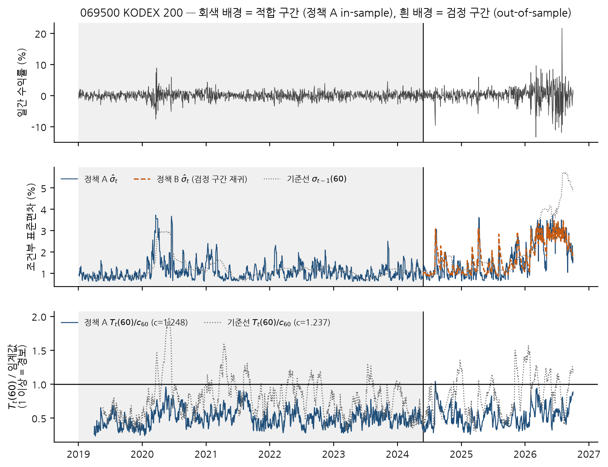<br><sub>그림 2. KODEX 200 — 회색 = 적합 구간(in-sample), 흰색 = 검정 구간. 가운데: 정책 A(실선)·B(주황 점선)·기준선(점선) σ. 아래: w=60 통계량/임계값 (1 이상 = 경보).</sub></p>

### 5.3 같은 지수, 다른 결론 (RQ5)

| 코드 | 종목 | SVR C/γ²/ε | T_A | T_B | 수익률 상관 (vs 069500) | 정책 A 잔차 상관 |
|---|---|---|--:|--:|--:|--:|
| 069500 | KODEX 200 | 1/0.5/0.1 | 1.403 | 2.026 | 1.0000 | 1.0000 |
| 102110 | TIGER 200 | 100/1/0.1 | 0.646 | 0.731 | 0.9994 | 0.9891 |
| 122630 | KODEX 레버리지 | 10/1/0.1 | 0.699 | 1.625 | 0.9980 | 0.9892 |
| 114800 | KODEX 인버스 | 10/0.5/0.1 | 0.899 | 2.298 | -0.9955 | -0.9867 |

KODEX 200 과 TIGER 200 은 수익률 상관 **0.9994** — 사실상 같은 시계열이다. 그런데 정책 A 통계량은 **1.403 (기각) vs 0.646 (비기각)**. 차이는 SVR 초모수(C=1 vs C=100) 선택에서 나왔고, 2026년 고변동기에 TIGER 200 의 $\hat g$ 가 σ̂ 를 더 크게 잡아 잔차를 더 눌렀다. 이동창 통계량 상관도 0.868 에 그친다. → **결과가 시장보다 모형 선택에 더 크게 좌우된다.**

<p align="center">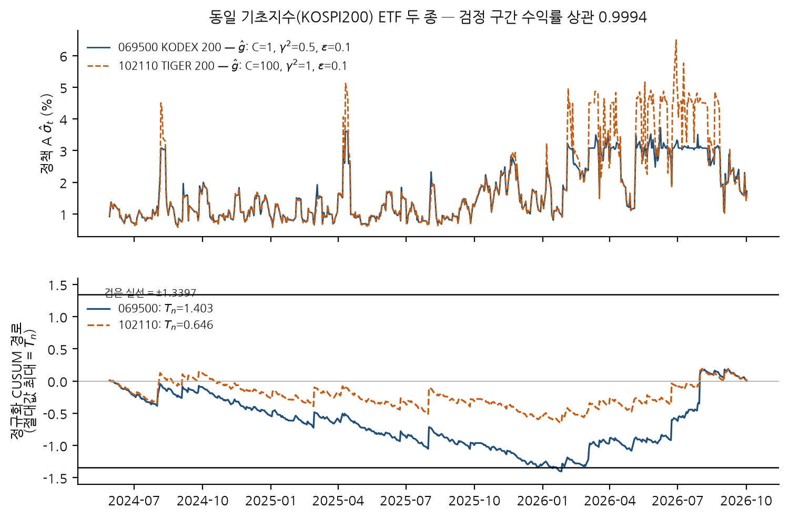<br><sub>그림 3. 위: 두 ETF 의 정책 A σ̂ (검정 구간). 아래: 정규화 CUSUM 경로 — 절대값 최대가 T_n. 069500 만 ±1.3397 선에 닿는다.</sub></p>

### 5.4 관측창별 경보 빈도 — 분모를 나눠 보면 (RQ3)

기존 요약 '정책 A 0.39 vs 귀무 1.71 회/년' 의 분모는 **전 기간 1902 거래일 / 252 = 7.548년** 이고 in-sample 적합 구간이 섞여 있다. 나눠 보면:

| 잔차 | w | 전 기간 | 적합 구간 (in-sample) | **검정 구간 (out-of-sample)** | iid 귀무 기대 | 검정 경보 0건 ETF |
|---|--:|--:|--:|--:|--:|--:|
| 정책 A | 20 | 2.23 | 2.1 | **2.63** | 4.05 | 0/20 |
| 정책 A | 30 | 0.87 | 0.75 | **1.26** | 3.02 | 1/20 |
| 정책 A | 60 | 0.39 | 0.35 | **0.47** | 1.71 | 10/20 |
| 정책 A | 120 | 0.25 | 0.22 | **0.39** | 0.99 | 13/20 |
| 정책 A | 252 | 0.21 | 0.21 | **0.47** | 0.56 | 14/20 |
| 기준선 | 20 | 6.26 | 6.33 | **6.76** | 4.04 | 0/20 |
| 기준선 | 30 | 5.31 | 5.44 | **5.86** | 2.93 | 0/20 |
| 기준선 | 60 | 3.82 | 3.84 | **4.48** | 1.7 | 0/20 |
| 기준선 | 120 | 2.73 | 2.81 | **3.62** | 0.97 | 0/20 |
| 기준선 | 252 | 1.28 | 1.4 | **2.09** | 0.57 | 0/20 |

단위: 연간 경보 에피소드, 20종 평균. 임계값 = ETF 별 iid 부트스트랩 95%.

<p align="center">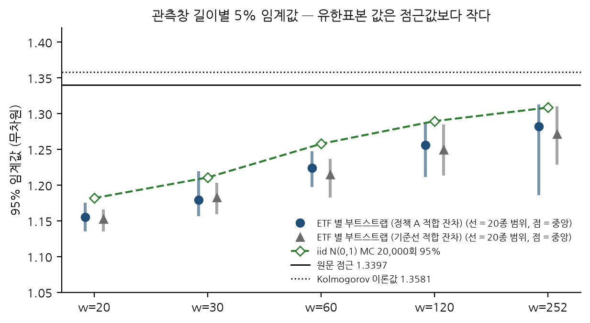<br><sub>그림 4. 창이 짧을수록 유한표본 임계값이 작다 — 짧은 창에 1.3397 을 쓰면 지나치게 보수적.</sub></p>

<p align="center">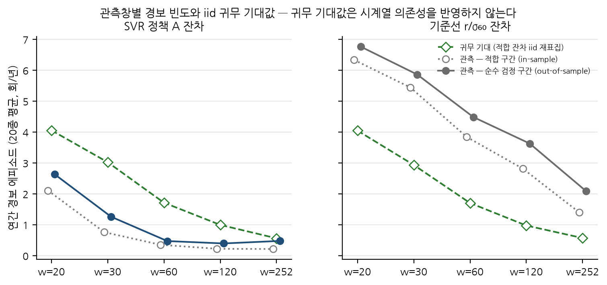<br><sub>그림 5. 정책 A 는 모든 창에서 귀무 기대보다 적고, 기준선은 모든 창에서 많다. 그러나 귀무 기대(iid)는 시계열 의존을 반영하지 않는다 → 5.7절.</sub></p>

<p align="center"><br><sub>그림 6. 20종 × 날짜 × 5개 창의 T/c 지도 (기존 T11 그림). 진할수록 경보에 가깝다. 청록선 = 분할.</sub></p>

<p align="center"><br><sub>그림 7. 달력연도별 사후 통계량 (굵게 = 1.3397 이상). 기준선은 2020년 85%·2026년 55% 기각, 정책 A 는 2020·2022년 5% 외 0%. 정책 A 2019–2024.5 는 in-sample.</sub></p>

### 5.5 시점 무결성 — 미래가 과거에 새지 않나 (E4)

KODEX 200 의 검정 구간 2025-08-22 이후 수익률만 3배로 바꾸고 전체를 다시 돌렸다 → $\hat g$ 동일, 그 이전의 잔차·이동창 통계량 **18/18 비트 동일**. 반대로 적합 구간을 바꾸면 $\hat g$ 와 이후 전부가 바뀐다 — 적합 구간 값은 설계상 in-sample 이므로 성능 판단에 쓰지 않는다.

### 5.6 합성 자료로 잰 크기·검정력 — 핵심 결과 (RQ4, E1·E2)

정답(변화 시점)을 알고 만든 GARCH(1,1) 자료(ω=0.05, α=0.08, β=0.90, n=1,902, 70/30 동일)에 **T11 파이프라인 전체**(grid 선택 포함)를 500회씩 돌렸다. 대립은 검정 구간 286번째 날부터 ω×3 (무조건분산 3배).

| 측정 | 정책 A | 정책 B | 기준선 | 바람직한 값 |
|---|--:|--:|--:|---|
| 사후 검정 **크기** (변화 없음, %) | 2.4 | 34 | 24.6 | ≈ 5 |
| 사후 검정 **검정력** (분산 3배, %) | 19 | 73 | 28.8 | 높을수록 |
| w=60 귀무 연간 경보 (회/년) | 0.1 | 2.41 | 4.1 | 낮을수록 |
| w=60 변화 후 20일 안 경보 (%) | 2 | 28.2 | 61.8 | 높을수록 |
| w=60 변화 후 60일 안 경보 (%) | 6.4 | 51.2 | 84.6 | 높을수록 |
| w=60 첫 경보 지연 중앙값 (거래일) | 138 | 41 | 12 | 짧을수록 |

<sub>MC 표준오차 ≤ 2.2%p (R=500). 참고: 변동성 모형 없이 GARCH 수익률을 그대로 검정하면 크기가 85.7% (E1) — 표준화가 필수인 이유.</sub>

<p align="center">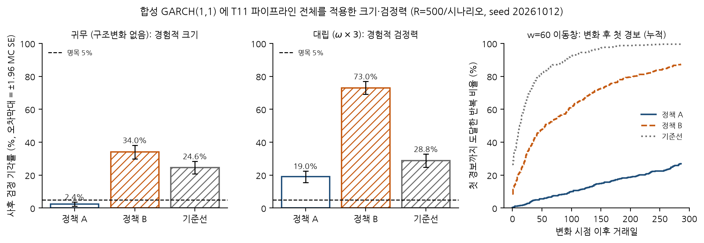<br><sub>그림 8. 왼쪽 = 크기(점선 5%), 가운데 = 검정력, 오른쪽 = 변화 후 첫 경보까지의 누적 비율. 정책 A 는 크기는 지키지만 거의 못 잡고, B·기준선은 잘 잡는 듯하지만 변화가 없어도 자주 울린다.</sub></p>

**읽는 법**: 정책 B 의 실제 ETF 기각 9/20 은, 변화가 없을 때도 34% 를 기각하는 검정의 결과라서 **구조변화 증거로 읽을 수 없다**. 정책 A 의 비기각 18/20 은 검정력이 19% 인 검정의 결과라서 **'변화 없음' 의 증거도 아니다**.

### 5.7 왜 정책 A 는 이렇게 조용한가 — 잔차 의존성과 귀무 선택 (RQ4, E3·E6)

- **잔차 제곱의 음의 자기상관 (E6)**: 정책 A 는 직전 5일 proxy 를 입력으로 쓰므로, 큰 충격 다음 날 σ̂ 가 커져 잔차 제곱이 작아진다. 장기분산/τ̂² 비 중앙값: 정책 A 검정 구간 **0.91** (18/20 < 1), 합성 귀무 **0.66** (100/100 < 1). 1 미만이면 τ̂ 정규화가 통계량을 눌러 덜 기각한다. 기준선은 반대로 1.49 (양의 군집) → 과다 기각.
- **귀무를 바꾸면 결론이 바뀐다 (E3)**: 임계값을 iid 재표집 대신 stationary bootstrap(블록 20)으로 만들면 n=571 임계값 중앙값 1.31 → 1.04, 정책 A 기각 ETF 가 {069500, 091230, 153130, 261220} → {069500, 091230, 143860, 132030} 로 **절반이 바뀐다** (겹침 2). 이것은 개선이 아니라 **다른 귀무가설**이다.
- **정책 B 이동창 (E5)**: 같은 임계값으로 검정 구간 경보 0.47 → 2.41 회/년 — 귀무에서의 B 경보율(E2 2.41)과 같은 수준.

<p align="center">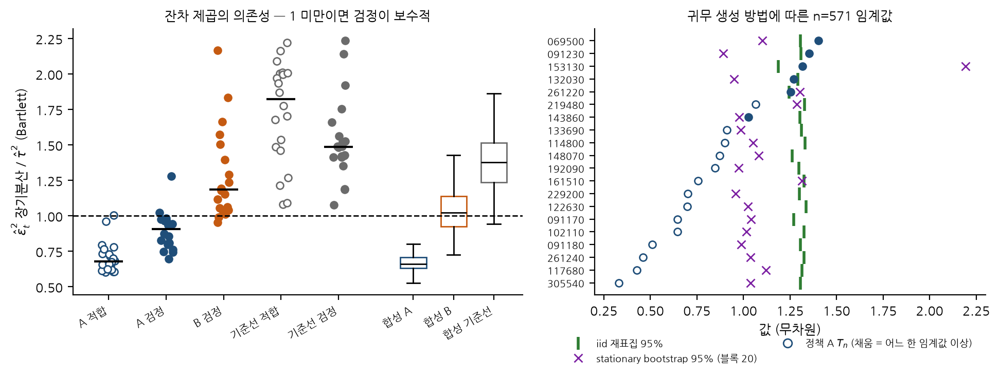<br><sub>그림 9. 왼쪽: 잔차 제곱의 장기분산/τ̂² (1 미만 = 보수적). 오른쪽: 두 귀무 방식의 n=571 임계값과 정책 A 의 T.</sub></p>

### 5.8 원 논문 충실도 (Track B, 재인용)

| 계열 | 원문 T / 변화점 | 재현 정책 A | 재현 정책 B |
|---|---|---|---|
| sp500 | 2.4751 / 2015-08-18 | 0.754 / 2015-06-26 | 1.0963 / 2015-08-18 |
| kospi | 1.5081 / 2018-01-22 | 0.791 / 2018-03-22 | 1.1071 / 2017-11-24 |
| krw_usd | 4.2754 / 2014-09-26 | 0.7939 / 2014-09-09 | 1.0238 / 2014-09-09 |

원문 통계량은 모두 기각, 재현은 모두 비기각. 원문 Monte Carlo 45셀 중 재현 95% CI 안: clip 1/45 · raise 9/45 · recursive 10/45. → **계산은 결정적으로 재현되지만 원문 수치는 재현되지 않는다** (METHOD_FIDELITY_UNRESOLVED). 그래서 위 ETF 결과를 '원 논문 방법의 결과' 라고 부르지 않는다.

---

## 6. 그래서 무엇을 말할 수 있나

| RQ | 판정 | 근거 | 상태 |
|---|---|---|---|
| RQ1 구조변화가 남는가 | **확정 불가** | A 2/20 기각이나 검정력 19%·보수적, B·기준선은 크기 왜곡 | UNRESOLVED |
| RQ2 정책 민감도 | 정책 선택이 결과를 지배 | 기각 2 → 9/20, B 의 귀무 크기 34% | VERIFIED |
| RQ3 관측창 | 창↑ → 임계값↑·경보↓, 짧은 창에 점근값은 과보수 | 5.4절, E1 | VERIFIED |
| RQ4 귀무모형 | iid 임계값은 잔차 의존을 무시, 귀무 선택에 따라 기각 집합 절반 변화 | E1·E3·E6 | VERIFIED (EXTENSION) |
| RQ5 동일 지수 일관성 | 갈린다 (초모수 의존) | 069500 1.403 vs 102110 0.646 | VERIFIED |
| RQ6 시장 상태로 해석 | 상태의 조작적 정의·관측모형 없이는 불가 | 7절 | HYPOTHESIS |

**하지 말아야 할 해석**

- ❌ '기각하지 않았으니 시장이 안정적이었다' · ❌ '기각했으니 투자자가 느끼는 국면 전환이 있었다'
- ❌ '경보가 적으니 오탐이 적은 좋은 탐지기' · ❌ '정책 B 가 더 많이 잡으니 더 낫다'
- ❌ '$\hat k$ = 그날 실시간으로 잡았다' · ❌ '이 검정으로 급등을 탐지한다' (방향이 없는 분산 검정)

---

## 7. 한계와 다음 연구

**한계**: 원 논문 미재현 · 합성 자료는 정규 GARCH(1,1) 하나와 ω 변화 하나 · 검정 구간 571일 하나(2026 고변동기 포함) · 시장 상태의 정답 부재 · 이미 여러 번 분석된 자료(탐색적) · SVR grid 하한 ε=0.1 이 실제 20/20·합성 98.8% 에서 선택(grid 확장 미실행).

**다음 연구는 탐지기 개선이 아니다.** 먼저 '시장 상태' 를 조작적으로 정의하고, 자료에서 식별되는지 검증한다.

| 기호 | 뜻 |
|---|---|
| $O_t$ | 관측 — 수익률, 변동성, 거래량, 자산 간 관계, (후보로서) CUSUM 통계량 |
| $S_t$ | 관측되지 않는 잠재 시장 상태 |
| $P(S_t\mid S_{t-1})$ · $P(O_t\mid S_t)$ | 상태전이 모형 · 관측모형 |
| $P(S_t\mid O_{1:t})$ | 시점 t 까지의 관측으로 얻은 사후 믿음 (belief) |

<p align="center">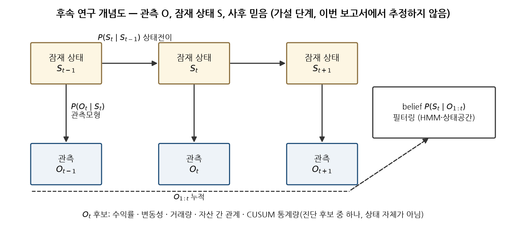<br><sub>그림 10. 후속 연구 개념도 — 가설 단계, 이번에 추정하지 않음.</sub></p>

1. 상태의 조작적 정의 (사건 집합을 정답으로 쓰지 않음, 팀 승인) → 2. 알려진 HMM 합성 자료로 식별 실험 → 3. 실제 ETF 에 HMM/상태공간 적합·안정성 → 4. CUSUM 통계량을 관측 후보로 넣었을 때의 정보 기여 (out-of-sample 로그우도) → 5. belief 위의 의사결정 (DP 또는 Active Inference — 서로 다른 방법, 보상·선호 정의 후).

---

## 8. 재현

```bash
git clone -b 1012_SVR-GARCH-CUSUM https://github.com/nanahyun3/R2H.git && cd R2H
uv sync --frozen --extra dev --extra notebook --extra research
uv run pytest -q                                                    # 98 passed
ETF_RAW_DIR=<원시 시세 폴더> uv run python scripts/run_svr_garch_cusum_etf.py   # 결과표 9종 + outputs/cache/t11_state.npz (약 2–3분)
D=deliverables/R2H_T11_CUSUM_Final_Review/scripts
uv run python $D/01_recompute.py      # 결과표 독립 재계산 → analysis/
uv run python $D/02_extension.py      # E1–E6 → extension/ (E2 는 20 프로세스로 약 1분)
uv pip install python-docx==1.2.0 latex2mathml==3.81.1 pymupdf==1.28.2   # 보고서 도구만
uv run python $D/03_claims.py && uv run python $D/04_figures.py && uv run python $D/05_build_docx.py
# Windows Word: powershell.exe -ExecutionPolicy Bypass -File $D/06_export_pdf.ps1 -Docx <docx> -Pdf <pdf>
uv run python $D/07_check_consistency.py && uv run python $D/08_build_readme.py
```

원시 시세가 없으면 FinanceDataReader 로 자동 수집하고 종가 해시를 대조한다 (FDR 이 분배를 소급 조정했으면 `DataVersionDiffers` 로 멈춘다). seed 20261012.

## 9. 이 브랜치에 추가된 파일

```
deliverables/R2H_T11_CUSUM_Final_Review/
├── R2H_T11_SVR_GARCH_CUSUM_최종연구보고서.docx / .pdf   최종 보고서 (32쪽, 표 19 · 그림 13 · 수식 6)
├── SOURCE_EVIDENCE_MATRIX.md      본문 수치 186개 ↔ 원천 파일·열·함수·상태
├── REPRODUCIBILITY_AUDIT.md       데이터 버전 · 환경 · 명령 · 테스트 · 미실행 범위
├── CHANGELOG_AND_OPEN_ISSUES.md   기존 T11 해석에서 제거·수정·보존한 것, 남은 과제
├── claims.json                    보고서·README 숫자의 단일 출처
├── analysis/                      재계산 결과 · 재현 로그 · 일치성 검수
├── extension/                     E1–E6 확장 실험 결과 (T11 원본 결과와 분리)
├── figures/                       그림 11종 PNG + SVG
└── scripts/                       01 재계산 → 02 확장 → 03 claims → 04 그림 → 05 DOCX → 06 PDF → 07 검수 → 08 README
docs/README_1012_baseline.md      1012 공통 README (변경 없이 보존)
pyproject.toml                    [tool.ruff] extend-exclude = ["deliverables"] 한 줄 (보고서 생성 스크립트를 lint 대상에서 제외)
```

`research/`·`src/`·`results/` 등 기존 T11 코드와 결과표는 **수정하지 않았다** (`1012` @ `a346faf` 와 동일). `main` 은 건드리지 않았다.

## 사용 예 — 결과 읽기와 R2H 공통 인터페이스

R2H 공통 인터페이스 (1012 와 동일, **합성 자료** — 실제 ETF 성능 아님):

```python
from r2h.detection import VolScaledThreshold
from r2h.evaluation import MatchConfig, event_metrics, match_alarms
from r2h.synthetic import InjectedSurge, ground_truth_from_injections, surge_series

surges = [InjectedSurge(start=300, length=10, drift=0.012)]
returns, calendar = surge_series(1000, surges, seed=1)  # 합성 일간 로그수익률 (실제 시세 아님)
truth = ground_truth_from_injections(calendar, surges, ticker="SYN")

signals = VolScaledThreshold(window=60, k=3.0).run(returns, ticker="SYN", data_version="synthetic")
alarms, events = match_alarms(signals, truth, calendar, MatchConfig(max_delay=5, cooldown=5, direction=1))
print(event_metrics(alarms, events, ticker_years=len(calendar) / 252))
```

이 연구의 결과 읽기 (원시 시세 불필요):

```python
import json
import pandas as pd

D = "deliverables/R2H_T11_CUSUM_Final_Review"
claims = json.load(open(f"{D}/claims.json", encoding="utf-8"))  # 보고서·README 숫자의 단일 출처
print(claims["E2_null_B_rej13397"])  # 값 · 원천 파일 · 상태(VERIFIED/REPORTED) · 비고
fs = pd.read_csv(f"{D}/analysis/fullsample_recomputed.csv", dtype={"ticker": str})  # ETF × 정책 사후 검정
print(fs.pivot(index="ticker", columns="policy", values="T").round(3).head())
e2 = pd.read_csv(f"{D}/extension/E2_pipeline_size_power_summary.csv", keep_default_na=False)  # 합성 크기·검정력
print(e2[e2.measure.str.startswith("posthoc_reject@paper")][["scenario", "residual", "value", "mc_se"]])
```

