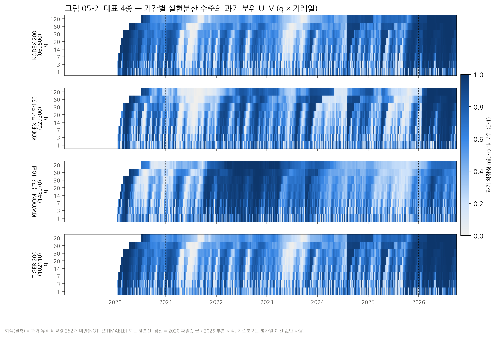
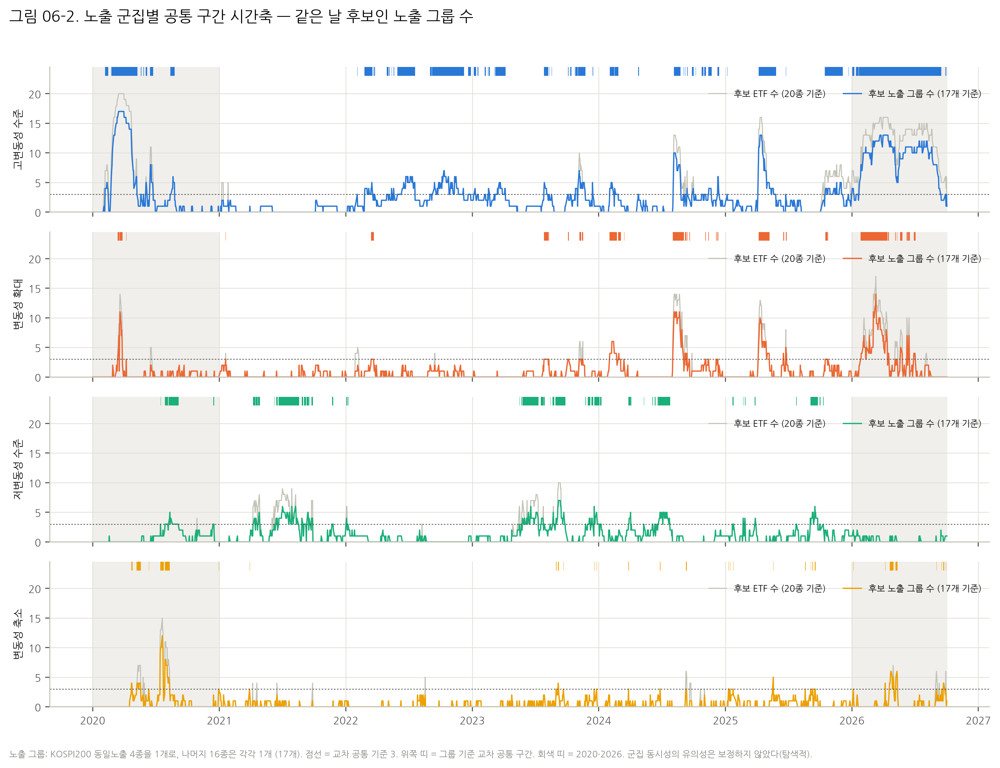
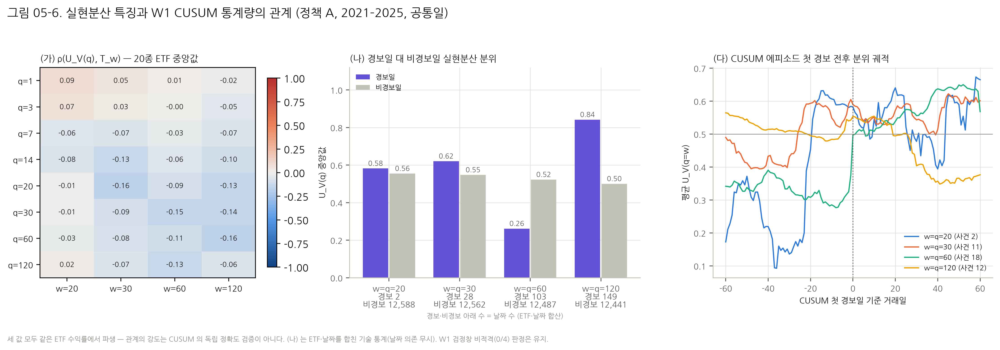
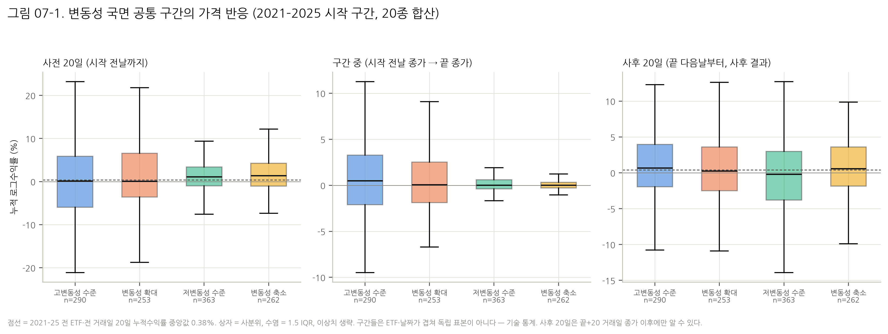

# R2H — 국내 상장 ETF 변동성 국면 연구

주가 급등 국면 포착 에이전트를 위한 기초 연구 (2026.9~2027.6, 홍익대학교 졸업 프로젝트)

`SVR–GARCH` · `CUSUM` · `다중 기간 실현분산` · `자산 간 공통 구간` — 국내 상장 ETF 20종, 2019-01 ~ 2026-10-02

<p>
  
  
  
  
  
  
  
</p>

> **이 브랜치(`1017_MultiHorizon_Volatility_Regime_W2`)의 현재 상태.**
> 1. 시장의 변동성은 하나의 수치나 하나의 경보로 충분히 설명되지 않았다. W2 에서는 시간 규모, 수준과 변화, 자산 간 공통성에 따라 서로 다른 양상이 관찰됐다.
> 2. 공통성을 **관찰**한 것과 통계적으로 특별한 구조변화를 **확인**한 것은 다르다. W2 의 모든 결과는 탐색적 기술이며 보정된 귀무분포가 없다. W1 에서 드러난 CUSUM 검출력 문제도 해결되지 않았다.
> 3. 지금까지의 연구는 그 차이를 기술하고 검증할 기초를 만들었다. 다음 08 은 기존 시장 동조성을 넘어서는 GARCH–CUSUM 공통 반응을 식별할 수 있는지 조사한다 (설계 중, 결과 없음).

**바로 가기** — [W2 종결 보고](research/multihorizon_w2/FINAL_W2_RESEARCH_REPORT.md) · [W2 연구계약](research/multihorizon_w2/W2_연구계약.md) · [노트북 05](notebooks/05_개별ETF_다중기간_변동성국면연구.ipynb) · [06](notebooks/06_노출군집_공통변동성구간_연구.ipynb) · [07](notebooks/07_가격반응_ETF상대움직임_CNN인계.ipynb) · [CNN 인계계약](research/multihorizon_w2/CNN_후보구간_인계계약_W2.md) · [릴리스 매니페스트](research/multihorizon_w2/W2_RELEASE_MANIFEST.json) · [이전 README 보존본](docs/history/README_1012_T11_T12_W1.md)

---

## 1. Research Snapshot — W2 핵심 발견

모두 같은 2019–2026 가격 자료에서 사후로 기술한 값이다. 주 해석 기간은 2021–2025 다. 2020 은 파일럿이고, 2026 은 부분·비블라인드 기간이다.

| # | 발견 | 수치 | 근거 |
|---|---|---|---|
| F1 | 변동성 **수준**과 **변화**는 서로 다른 날을 가리킨다 | 고변동성·확대 후보일 Jaccard 중앙값 **0.27** | `results/05/h1_level_vs_change_jaccard.csv` |
| F2 | 여러 시간 규모가 함께 반응한 공통 구간이 반복된다 | 2021–2025 공통 구간 **1,168개** (7/7 동시 반응: 고변동성 23 · 확대 2) | `results/05/overlap_intervals.csv` |
| F3 | 같은 지수 상품과 다른 노출의 공통성은 크게 다르다 | KOSPI200 4종 Jaccard **0.75–0.99**, 노출이 다른 쌍 중앙값 **0.09–0.18** (고변동성·확대 채널) | `results/06/within_group_pair_jaccard.csv` · `all_pair_jaccard.csv` |
| F4 | 시장 공통 반응은 사건과 자산군마다 다르다 | 변동성 확대: 2024-08 **11개**, 2025-04 **10개** 노출 그룹 (17개 중). 2022 고변동성은 KOSPI200 없이 채권·통화·미국 주식이 함께 반응 | `results/06/cross_intervals_group.csv` |
| F5 | W1 CUSUM 통계량과 실현분산 수준의 관계는 약하다 | ETF 중앙 Spearman ρ **−0.11 ~ −0.01** | `results/05/h3_spearman.csv` |
| F6 | 변동성 상태는 가격 방향과 일관되게 연결되지 않았다 | 구간 중 상승 비율 **51.2–60.3%** | `results/07/interval_price_reaction.csv` |

경로는 모두 `research/multihorizon_w2/` 아래다. 같은 수치가 05·06·07 노트북 본문에 있고, 노트북 본문 수치는 CLAIMS assert 47개가 실행 결과와 대조한다.

---

## 2. Research Roadmap — 연구 계보

| 단계 | 연구 | 핵심 결과 | 상태 |
|---|---|---|---|
| 1012 | ETF EDA · Track A 상관 전환 · Track B 논문 재현 | 20종 자산 구조와 중복 노출 규칙 확정. 상관 전환은 우연 수준(부정적 결과). Lee·Kim·Lee (2020) 원문 수치는 미재현 (`METHOD_FIDELITY_UNRESOLVED`) | 완료 |
| T11 | SVR–GARCH CUSUM × ETF 20종 (70/30 · 이동창) | 정책 A 경보율이 iid 기준 미만 (w=60 0.39 vs 1.71/년). 사건 근접은 우연 수준 (최소 q=0.57). 테스트 분산 입력 규칙 하나로 기각 수가 4.5배 달라짐 | 완료 |
| T12 | 연간 expanding 사후 검정 · 강건성 | 2021–2025 연간 기각 A/B/기준선 **0/12/6** (각 100 ETF-연도). 군집 귀무에서 크기 0.39–0.58 로 왜곡. 정책 A 파이프라인 검정력 0.085 | 완료 |
| W1 (03·04) | 이동 CUSUM 검정창 w 선정 · 20종 일반화 | **적격 창 0/4, 최적창 없음.** 지속 분산 ×2·×0.5 의 60일 검출률 0.03–0.10 | 완료 (부정적 결과) |
| **W2 (05·06·07)** | 다중 기간 변동성 상태 · 노출 군집 공통 구간 · 가격 반응 | 탐색적 공통 구간 1,711개 (2021–2025 1,168). 독립적 유의성은 검증하지 않음 | **완료 (탐색적)** |
| 08 | 자산 간 GARCH–CUSUM 공통 반응 식별 | 설계 중, 결과 없음 | 예정 |

**W1 과 W2 의 관계.** W2 는 W1 의 검정창 문제를 푼 연구가 아니다. W1 의 결론(적격 창 0/4)은 그대로 유지된다. W2 는 연구 대상을 바꿨다. CUSUM 이라는 단일 검정의 경보가 아니라 변동성 **상태 자체**를 여러 시간 규모로 기술하고, 그 상태가 자산 사이에서 언제 함께 나타나는지를 본다. W1 의 CUSUM 은 W2 에서 비교 대상(H3)으로만 쓰였고, 일별 경보를 다시 계산해 W1 집계 6,720행과 일치함을 확인했다.

---

## 3. W2 — 다중 기간 변동성 국면 (05 · 06 · 07)

### 3.1 무엇을 쟀나

일간 로그수익률 `r_t = 100·log(C_t / C_{t−1})` [%] 에서 q 일 실현분산과 직전 대비 변화를 만든다.

$$V^{(q)}_t=\frac1q\sum_{s=t-q+1}^{t} r_s^2,\qquad D^{(q)}_t=\log\frac{V^{(q)}_t}{V^{(q)}_{t-q}},\qquad q\in\{3,7,14,20,30,60,120\}$$

각 값을 **그 ETF 의 과거 값만으로** mid-rank 분위 `U = (#{X<x} + 0.5·#{X=x}) / n` 로 바꾼다. 기준집합은 평가일보다 엄밀히 앞선 날짜이고, 유효 비교값이 최소 252개 있어야 한다.

| 상태 | 규칙 | 뜻 |
|---|---|---|
| `HIGH_LEVEL` | `U_V ≥ 0.90` | 지금 변동성이 그 ETF 의 과거 상위 10% 수준이다 (이미 높은 상태) |
| `LOW_LEVEL` | `U_V ≤ 0.10` | 과거 하위 10% 수준의 조용한 상태다 |
| `EXPANSION` | `U_D ≥ 0.90` | 직전 q 일 대비 분산이 과거 상위 10% 만큼 **빠르게 늘었다** |
| `CONTRACTION` | `U_D ≤ 0.10` | 직전 q 일 대비 분산이 과거 하위 10% 만큼 줄었다 |

7개 q 가운데 3개 이상이 같은 날 같은 상태면 후보일이고, 연속된 후보일이 **공통 구간**이다. `HIGH_LEVEL` 과 `EXPANSION` 은 다르다. 높은 변동성이 오래 지속되면 `HIGH_LEVEL` 이지만 더는 `EXPANSION` 이 아니다. F1 의 Jaccard 0.27 이 이 차이를 수치로 보여 준다.

> 이 네 상태는 과거 분포의 상·하위 10% 라는 **경험적 규칙**이다. 참 레짐이나 통계적으로 검증된 변화점이 아니다. 규칙과 임계값은 신호를 계산하기 전에 계약 커밋 `1fbdb1d` 에 동결했다.

### 3.2 가설과 판정

| 가설 | 지지하는 관찰 | 비지지·제한 | 판정 형태 |
|---|---|---|---|
| H1 개별 ETF 의 상태 반복 | 20종 모두 상태가 반복된다. 수준과 변화가 다른 날을 가리킨다 | 자기 과거 기준에 의존 (2019–2020 기준기간 효과) | 탐색적 기술 |
| H2 다중 기간 중첩 | 7/7 동시 구간이 있다 (고변동성 23) | 보정된 중첩 귀무 없음. 확대·축소 7/7 은 드묾 | 기술적 순위 |
| H3 CUSUM 과의 관계 | w=120 경보일의 U_V 중앙 0.84 (비경보 0.50) | ρ ≈ 0. w=60 은 반대 (0.26 vs 0.52). 공통 구간의 42% 는 연초라 CUSUM 미계산 | 관계 미약 · W1 비적격 유지 |
| H4 자산 간 공통성 | 같은 노출은 거의 같은 신호. 2024-08 · 2025-04 · 2022 공통 사건 | 다른 노출 일치도 낮음. 귀무 보정 없음 | 탐색적 공통성 |
| H5 가격 반응 | 상태별 사전 가격·상대 움직임 차이. 레버리지 추적 차이 −0.54 → −1.21%p (사후 분할) | 방향 혼재. 사후 20일 상대값이 네 상태 모두 음수 (원인 판단 불가) | 기술적 관계 |

### 3.3 주요 그림

<p align="center"></p>

**그림 05-2 — 다중 기간 변동성 수준 지도 (대표 4종).** 같은 ETF 에서도 짧은 q 는 며칠 단위로 깜빡이고, 긴 q 는 몇 달 단위 국면을 그린다. KODEX 200 과 TIGER 200 은 거의 같은 무늬다 (F3). 국고채10년은 2022–2023 에 주식과 다른 시점에 장기 고변동성이 이어졌다. 색은 자기 과거 기준의 분위이므로 ETF 간 절대 변동성 크기를 비교하는 그림이 아니다.

<p align="center"></p>

**그림 06-2 — 노출 그룹별 공통 구간 시간축.** KOSPI200 4종을 한 그룹으로 묶은 17개 노출 그룹 가운데 같은 날 후보인 그룹 수다. 변동성 확대는 2024-08 과 2025-04 에 넓게 동시 발생했다. 2022 고변동성은 채권·통화·미국 주식이 이끌었다. 점선(3개 그룹)은 기술용 기준이며 동시성의 유의성은 보정하지 않았다.

<p align="center"></p>

**그림 05-6 — 실현분산과 W1 CUSUM 의 관계 (정책 A, 2021–2025).** (가) 순위상관은 모든 q×w 칸에서 0 근처다. (나) w=120 경보일은 높은 분위에 몰리지만 w=60 은 반대다. 두 값 모두 같은 수익률에서 나왔으므로 이 관계는 CUSUM 정확도의 독립 검증이 아니다. W1 의 비적격 판정(0/4)은 그대로다.

<p align="center"></p>

**그림 07-1 — 상태별 가격 반응 (2021–2025 시작 구간).** 네 상태 모두 구간 중 수익률 중앙값이 0 근처이고 분산만 다르다. 저변동성·축소는 조용한 상승 뒤에 나타났다 (사전 20일 +1.11 · +1.40%). **사후 20일 값은 구간이 끝난 뒤에야 알 수 있는 결과**이며 예측 성능이 아니다. 구간들은 ETF·날짜가 겹쳐 독립 표본이 아니다.

나머지 17장 (05: 11 · 06: 5 · 07: 5, PNG 320dpi + SVG) 은 [`research/multihorizon_w2/figures/`](research/multihorizon_w2/figures) 와 각 노트북에 해석과 함께 있다.

---

## 4. Findings & Limitations — 확인한 것과 아직 말할 수 없는 것

| 계산으로 확인한 사실 | 가정 아래에서만 가능한 해석 | 현재 자료로 판단할 수 없는 주장 |
|---|---|---|
| W1 일별 CUSUM 경보 재계산 = W1 집계 6,720행 | 확장형 과거 분포를 '그 ETF 의 정상 상태' 로 볼 때만 상위 10% 를 '이례적' 이라 부를 수 있다 | 공통 구간·교차 공통성의 통계적 유의성 |
| 공통 구간·교차 구간·순위가 새 커널 결정적 실행에서 재생성됨 (CLAIMS 47개) | 분산 손실 공식이 레버리지 추적 차이의 방향을 설명한다 (보수·괴리와 분리 검정 안 함) | CUSUM 의 참 구조변화 검출 |
| CNN 후보 1,711행 · 필수 22개 필드 · 라벨 열 없음 | | 구간 시작일의 실시간 경보 가치 · 가격 급등 예측력 · 독립 외부 검증 |

**주요 한계.**
- **귀무분포 없음.** 기간 간 의존을 보존한 중첩 귀무와 자산 간 원형 이동 귀무를 사전 등록하기 전까지 H2·H4 의 유의성은 말할 수 없다.
- **CUSUM 비교 범위.** CUSUM 은 연도별 적합이라 연초 119 거래일이 빠진다. 2021–2025 공통 구간 1,168개 중 496개는 CUSUM 을 하루도 계산할 수 없었다.
- **경보 방향.** CUSUM 경보를 분산 증가와 감소로 나누지 않았다.
- **2026.** 전체 순위 상위를 차지하지만 부분·비블라인드 자료라 주 해석에서 뺐다.
- **계약 외 사후 분석 7건**을 [보고서 §4a](research/multihorizon_w2/FINAL_W2_RESEARCH_REPORT.md) 에 공개했다. 이 과정에서 07 초안의 '구성 효과' 해석을 사후 확인으로 철회했다 (ETF 자기 기준 대비로도 중앙 −0.84%p, 14/20 음수).

---

## 5. Notebooks & Evidence

| 노트북 | 질문 | 주요 결과 파일 |
|---|---|---|
| [05 개별 ETF 다중 기간 변동성 국면](notebooks/05_개별ETF_다중기간_변동성국면연구.ipynb) | 한 ETF 안에서 어떤 상태가 어떤 기간 조합으로 나타나나 (H1–H3) | `overlap_intervals.csv` · `h1_level_vs_change_jaccard.csv` · `h3_*.csv` · `cusum_w1_reconciliation.csv` |
| [06 노출 군집 공통 변동성 구간](notebooks/06_노출군집_공통변동성구간_연구.ipynb) | 같은 상태가 여러 노출 그룹에 함께 나타나나 (H4) | `within_group_pair_jaccard.csv` · `cross_intervals_group.csv` · `global_interval_rank.csv` |
| [07 가격 반응 · ETF 상대 움직임 · CNN 인계](notebooks/07_가격반응_ETF상대움직임_CNN인계.ipynb) | 상태별 가격·상대 움직임은 어떤가, CNN 에 무엇을 넘기나 (H5) | `interval_price_reaction.csv` · `cnn_candidate_intervals_w2.csv` |

| 문서 | 역할 |
|---|---|
| [`FINAL_W2_RESEARCH_REPORT.md`](research/multihorizon_w2/FINAL_W2_RESEARCH_REPORT.md) | 감사 질문 10개 · 주장→근거 C1–C13 · 게이트 G0–G7 · 한계 |
| [`W2_연구계약.md`](research/multihorizon_w2/W2_연구계약.md) · [`CONTRACT_FREEZE_SHA256.txt`](research/multihorizon_w2/CONTRACT_FREEZE_SHA256.txt) | 사전 가설·정의·분석 규칙과 동결 해시 |
| [`CNN_후보구간_인계계약_W2.md`](research/multihorizon_w2/CNN_후보구간_인계계약_W2.md) | 후보 구간 필드 사전. **정답 라벨이 아니다.** `px_post_*` 는 입력 금지, `exposure_group` 단위 분할 |
| [`W2_RELEASE_MANIFEST.json`](research/multihorizon_w2/W2_RELEASE_MANIFEST.json) · [`evidence/REPRO_RUNS.md`](research/multihorizon_w2/evidence/REPRO_RUNS.md) | 릴리스 파일 해시 · 반복 실행 기록 |
| [`W1_PROTECTED_SHA256.csv`](research/multihorizon_w2/W1_PROTECTED_SHA256.csv) | W2 가 바꾸지 않은 W1·T12 파일 153개의 해시 (세 노트북 첫 셀이 대조) |

---

## 6. Reproducibility

**W2 재현에는 Git 에 없는 두 가지가 필요하다.** 저장소를 clone 하고 아래 명령만 실행하면 W2 결과가 자동으로 재현되는 것은 아니다.
1. 동결된 원자료 `data/raw` (20 ETF, SHA 고정). 재배포 권리를 확인하지 못해 커밋하지 않았다.
2. T12 일별 잔차 cache. 실행 스크립트는 이 저장소의 두 단계 위 `../../1016/R2H_T12_Final` 을 `T12_FROZEN_ROOT` 로 넘긴다 (`scripts/run_t14_notebooks.py` 의 `T12_FROZEN`). 다른 배치에서는 이 상수를 고친다.

```bash
git checkout 1017_MultiHorizon_Volatility_Regime_W2
uv sync --extra dev --extra notebook --extra research
uv run python scripts/t14_build_notebooks.py --write   # 05·06·07 생성 (출력 비움)
uv run python scripts/run_t14_notebooks.py             # 05→06→07 각각 새 커널, 약 2분
uv run pytest -q tests
uv run python scripts/t14_release_manifest.py         # 릴리스 해시 재계산
```

- 기준 환경: Python 3.12.3 · numpy 2.5.4 · pandas 3.0.6 · scipy 1.18.1 · matplotlib 3.11.2 (`uv.lock` 과 같은 버전). 실행 스크립트는 자기 인터프리터를 커널 `PATH` 맨 앞에 두고 user-site 를 끈다. 노트북 첫 셀이 버전과 원자료·계약·W1 보호 파일 해시를 assert 한다.
- 결정성: 05→06→07 를 새 커널로 반복 실행했을 때 결과·그림 77개와 Git 제외 작업 파일 7개가 바이트 단위로 같았다 (R3–R5).
- 일별 특징·상대수익률은 가격을 역산할 수 있어 `outputs/t14/` (Git 제외)에만 두고 해시만 기록한다.
- 세부 경로와 게이트는 [보고서 §7–§8](research/multihorizon_w2/FINAL_W2_RESEARCH_REPORT.md) 을 본다.

**검증 상태.** 로컬 `pytest -q tests` **176 passed**. W2 가 추가한 파일의 ruff 위반은 0건이고, 저장소 전체의 기존 ruff 부채 133건은 W1 시점과 같다. GitHub Actions CI 는 `1012`·`main` push 와 PR 에서만 돌기 때문에 이 브랜치에서는 실행되지 않았다.

**기본 패키지만 확인할 때** (원자료 불필요, 합성 데이터):

```bash
uv sync --extra dev --extra research && uv run pytest -q tests
uv run python examples/synthetic_demo.py --out outputs/synthetic_demo.json   # 두 번 실행해 출력 JSON 이 같아야 한다
```

원자료가 없는 깨끗한 checkout 에서는 `168 passed, 8 skipped` 다. 건너뛰는 8개는 `data/raw` 가 필요한 실데이터 테스트다.

---

## 7. Research Infrastructure

| 경로 | 내용 |
|---|---|
| [`src/r2h/multihorizon/`](src/r2h/multihorizon) | **W2** — 분산·분위·중첩 구간 (`core`) · 일별 CUSUM 재계산 (`cusum`) · 05/06/07 단계 · 관계 지표 · 그림 |
| [`src/r2h/window_study/`](src/r2h/window_study) · [`src/r2h/annual_expanding/`](src/r2h/annual_expanding) | W1 검정창 연구 · T12 연간 expanding |
| [`src/r2h/svrgarch_etf/`](src/r2h/svrgarch_etf) · [`src/r2h/paper2020/`](src/r2h/paper2020) | T11 오토런 · Track B 원본 모듈 (바이트 동일) |
| [`src/r2h/data/`](src/r2h/data) · [`features/`](src/r2h/features) · [`detection/`](src/r2h/detection) · [`evaluation/`](src/r2h/evaluation) · [`backtest/`](src/r2h/backtest) | 1012 공통 기준선 — 관측 계약 · feature · 탐지 인터페이스 · 사건 평가 · 체결 규칙 (SCHEMA_ONLY) |
| [`notebooks/`](notebooks) | 00–02 T12 · 03–04 W1 · **05–07 W2** · 1012 종합 · T11 |
| [`research/`](research) | 연구별 계약·결과·보고서 — `multihorizon_w2/` · `window_study_w1/` · `t12_annual_expanding_v2/` · `svr_garch_cusum_etf/` |
| [`scripts/`](scripts) | 노트북 생성기·실행기 (`t12_*` · `t13_*` · `t14_*`) · T11 오토런 |
| [`tests/`](tests) | unit · integration · property · leakage · 노트북 규칙 (모든 코드 줄 한국어 주석 강제) |
| [`docs/`](docs) | [계약 v0.1](docs/architecture/CONTRACT_v0.1.md) · [열린 결정](docs/decisions/OPEN_DECISIONS.md) · [출처](docs/provenance/PROVENANCE.md) · [이전 README 보존본](docs/history/README_1012_T11_T12_W1.md) |

### 규칙

- 온라인 신호는 `available_until <= signal_at` 이어야 한다 (검증 함수가 강제). 사후 검정은 `mode="posthoc"` 이며 온라인 평가에 넣을 수 없다.
- 정답 라벨은 탐지기와 독립된 정의로 만든다. W1·W2 의 경보와 후보 구간은 정답이 아니다.
- 연구마다 계약을 신호 계산 전에 커밋으로 동결하고, 결과를 본 뒤 추가한 분석은 계약 외로 따로 공개한다.
- 원시 시세·일별 수익률 파생값·API 키는 커밋하지 않는다.

### 사용 예

아래 블록은 테스트(`tests/integration/test_readme_example.py`)가 그대로 실행한다. 1012 공통 평가 계약을 **합성 데이터**로 보여 주는 예이며, 실제 ETF 성능이 아니다.

```python
from r2h.detection import VolScaledThreshold
from r2h.evaluation import MatchConfig, event_metrics, match_alarms
from r2h.synthetic import InjectedSurge, ground_truth_from_injections, surge_series

surges = [InjectedSurge(start=300, length=10, drift=0.012)]
returns, calendar = surge_series(1000, surges, seed=1)  # 합성 일간 로그수익률 (실제 시세 아님)
truth = ground_truth_from_injections(calendar, surges, ticker="SYN")

signals = VolScaledThreshold(window=60, k=3.0).run(returns, ticker="SYN", data_version="synthetic")
alarms, events = match_alarms(signals, truth, calendar, MatchConfig(max_delay=5, cooldown=5, direction=1))
print(event_metrics(alarms, events, ticker_years=len(calendar) / 252))
```

---

## 8. Next Research — 08 Bottom-up Cross-Asset GARCH–CUSUM Synchronization

> **상태: 설계 중. 계산한 결과가 없다.** 아래는 목적이며 기대 성과가 아니다.

**목적.** KOSPI200 과 KOSDAQ150 에서 시작해 국고채10년, 단기채권, 미국 나스닥100, WTI 원유선물로 자산을 순차적으로 넓히며 GARCH–CUSUM 통계량의 공통 반응을 조사한다.

**W2 에서 넘어온 문제.**
- W2 의 교차 공통성(F3·F4)에는 보정된 귀무분포가 없다. 08 은 단순한 경보의 시간적 중복이나 기존 자산 간 동조성으로 설명되지 않는 **추가적인** 공통 반응을 구별하려 한다. 이를 위해 자산별 시간 의존성과 다변량 의존 구조를 보존하는 귀무검정을 먼저 설계·등록한다.
- W2 에서 CUSUM 경보 방향(분산 증가·감소)을 나누지 않았고, 연초 커버리지도 비어 있었다.

**범위.** 공통 반응이 어떤 자산 조합과 기간에서 관찰되는지 식별한다. 가격 반응과의 관계는 별도 탐색 분석으로 평가한다. 08 이 끝나면 보고서와 산출값을 근거로 이 문서의 Research Snapshot 을 다시 쓴다.

---

## 9. References & History

| 연구 | 문서 |
|---|---|
| 1012 기준선 · EDA · Track A/B | [재현 상태표](research/REPRODUCTION_STATUS.md) · [EDA](research/etf_domain_eda.md) · [Track A](research/cross_asset_track_a.md) · [Track B](research/svr_garch_cusum_track_b.md) · [연구 종합 노트북](notebooks/R2H_1012_research_synthesis.ipynb) |
| T11 | [T11 README](research/svr_garch_cusum_etf/README.md) · [노트북](notebooks/R2H_T11_svr_garch_cusum_etf.ipynb) |
| T12 | [종결 보고](FINAL_RESEARCH_CLOSURE.md) · [재현 보고](research/t12_annual_expanding_v2/FINAL_REPRODUCTION_REPORT.md) · 노트북 [00](notebooks/00_환경과_데이터_검증.ipynb) → [01](notebooks/01_연간확장_실험재현.ipynb) → [02](notebooks/02_가설검증_강건성_심층해석.ipynb) |
| W1 | [종결 보고](research/window_study_w1/FINAL_03_04_RESEARCH_CLOSURE.md) · [연구계약](research/03_04_연구계약.md) · 노트북 [03](notebooks/03_대표4종_검정창선정_심층연구.ipynb) → [04](notebooks/04_전체20종_검정창일반화_강건성연구.ipynb) |
| 이전 README | [보존본](docs/history/README_1012_T11_T12_W1.md) — 1012 데이터 카드 · ETF 20종 명세 · 수식 · T11 상세 그림 |

- 원 논문: Lee, S., Kim, C. K., & Lee, S. (2020). *Hybrid CUSUM Change Point Test for Time Series with Time-Varying Volatilities Based on Support Vector Regression.* **Entropy** 22(5), 578 — [doi:10.3390/e22050578](https://doi.org/10.3390/e22050578)
- 데이터: [FinanceDataReader](https://github.com/FinanceData/FinanceDataReader) KRX 상장 ETF 일봉. 연구 원본은 [Siegfriex/SA_ETF](https://github.com/Siegfriex/SA_ETF) 에 있다.
- 열린 결정 (D-01 Ground Truth 정의 · D-02 오탐 상한 · D-03 2026 처리 · D-07 LICENSE 등): [OPEN_DECISIONS.md](docs/decisions/OPEN_DECISIONS.md)
